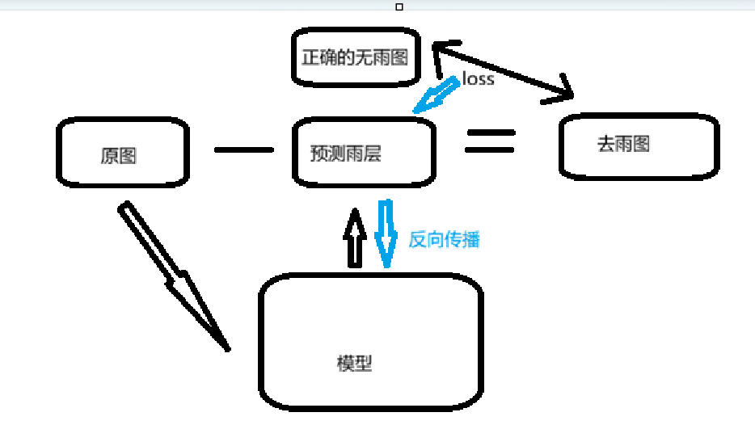
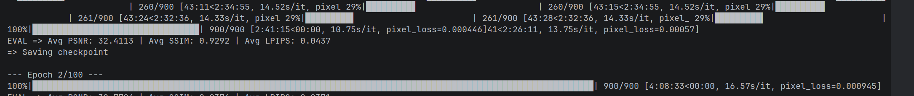

大声明：有些epoch没跑满是因为kaggle时间不够用了，我是CPU电脑....(〃＞目＜)

1. 基础问题
B残差学习：
- 画面大部分无雨区域对于R来说是空白（像素近似0），只需要学习雨层的像素更加简单
- 不需要重建张图片，只是从原图中去除雨丝就可以。相比于学习完整映射，更简单快捷 
- 恒等映射保底输出原图，不会乱给，保留背景
- 有雨图也可以看作叠加产生，刚好和残差的结构很像
自带的画图绘制的

附加
1. 
- 雨丝大部分大面积随机分散在整个图片上的，一些难以区分的，比如说头发丝或者物体上的条纹，是集中在物体上的 
- 雨丝是半透明的，而且亮
- 雨的边界更模糊，物体的条纹一般比较清晰
- 雨的颜色可能比较接近灰白，纹理的颜色就和物体是一样的
- 不只是学习纹理和雨丝像的细长的特点，颜色边缘和亮度，分布都是重要组成
2. 
完全覆盖的话很难，像素里面没有背景残留，信息已经丢失了，很难恢复，只能看它猜了，根据周围的来
可以生成理论上“合理”的内容，but不知道是否正确（相比于像素损失这种情况下感知损失会更合理）
多帧（视频）的去雨类型是可以根据其他帧来，但是单帧只能这样了

wa oh

