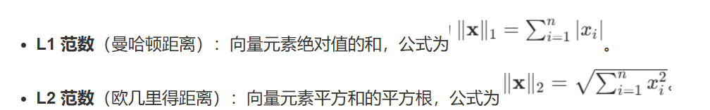

1. L1、L2 范数
- 定义
- 几何意义与例子：
    - L1（单位球是菱形） = 每个维度差值的**绝对值**加起来（和它来源的曼哈顿一样，只能方方正正的沿着马路走，和下棋的棋盘一样 ）
    - L2 （单位球是圆）= 每个维度差值的**平方**加起来再开根号（可以直接把两点之间的距离连起来 ）（对异常敏感）

2. 如何从图片得到
```
L1 loss = mean( |pred - clean| )
L2 loss = mean( (pred - clean)² )     
```
- L1
  - 逐像素、逐通道做差取绝对值
  - all数字加起来 
  - 除以总像素数取平均
- L2 
   - 逐像素做差平方
   - all加起来 
   - 除以总像素数取平均


## SSIM
1. SSIM 数值范围：[-1, 1],完全不一样对应 0（结构不相关），-1 表示结构完全反相（黑白互换），一般会把负值截断
2. SSIM 角度评估 
- **亮度**：整体亮暗 
- **对比度**：明暗反差 
- **结构**：物体的形状、轮廓、相对位置
3. SSIM 每次的评估是滑窗局部算,每滑到一个位置，就对窗口里那一小块图算一次 ,再把所有窗口的 SSIM 平均，得到整张图的SSIM

