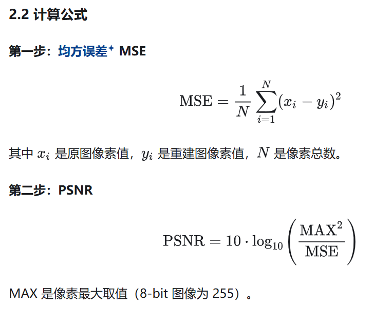
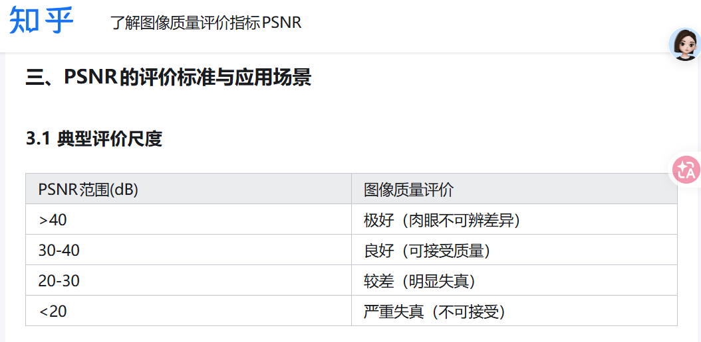
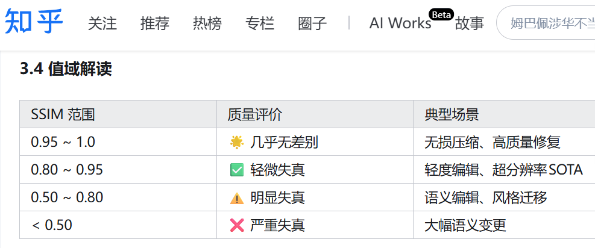

1. L1、L2 范数
- 定义!
[img_3.png](img_3.png)
- 几何意义与例子：
    - L1（单位球是菱形）（对应损失MAE） = 每个维度差值的**绝对值**加起来（和它来源的曼哈顿一样，只能方方正正的沿着马路走，和下棋的棋盘一样，咦但是有些棋子可以斜着走，所以这里说的是车）
    - L2 （单位球是圆）（对应损失MSE）= 每个维度差值的**平方**加起来再开根号（可以直接把两点之间的距离连起来 ）（对异常敏感）

2. 如何从图片得到
```
L1 loss = mean( |pred - clean| )
L2 loss = mean( (pred - clean)² )     
```
- L1
  - 逐像素、逐通道做差取绝对值
  - all数字加起来 
  - 除以总像素数取平均
- L2 
   - 逐像素做差平方
   - all加起来 
   - 除以总像素数取平均

总结来说就是先对齐进行逐元素相减，然后取绝对值或者平方，再求平均
这里的平均的默认计算方式是把像素的每个通道都当作独立个体计算，所有加起来再除以C*H*W
## PSNR


MAX 是像素最大取值（8-bit 图像为 255）如果进行了归一化就是1啦，比如说我写utils时
## SSIM
1. SSIM 数值范围：[-1, 1],完全不一样对应 0（结构不相关），-1 表示结构完全反相（黑白互换），一般会把负值截断
2. SSIM 角度评估 
- **亮度**：整体亮暗 ----比较均值
- **对比度**：明暗反差 ----比较方差
- **结构**：物体的形状、轮廓、相对位置 ----比较协方差
3. SSIM 每次的评估是滑窗局部算,每滑到一个位置，就对窗口里那一小块图算一次 ,再把所有窗口的 SSIM 平均，得到整张图的SSIM
知乎也被ai入侵了吗，找了个文章看看感觉也是ai，乐

so PSNR 看的是全局像素误差，SSIM 看的是局部结构相似