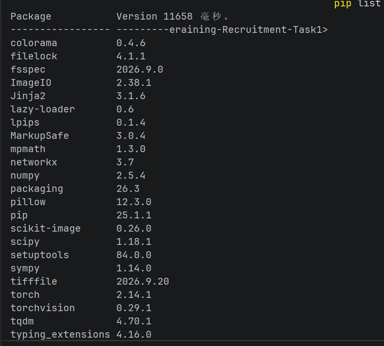
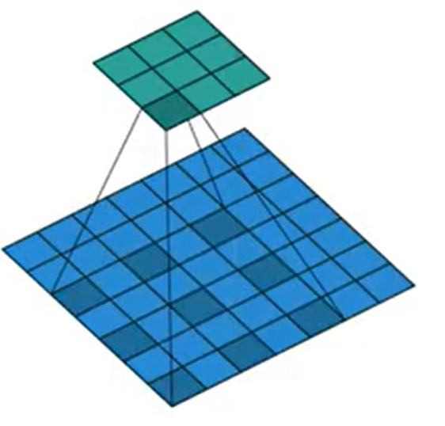
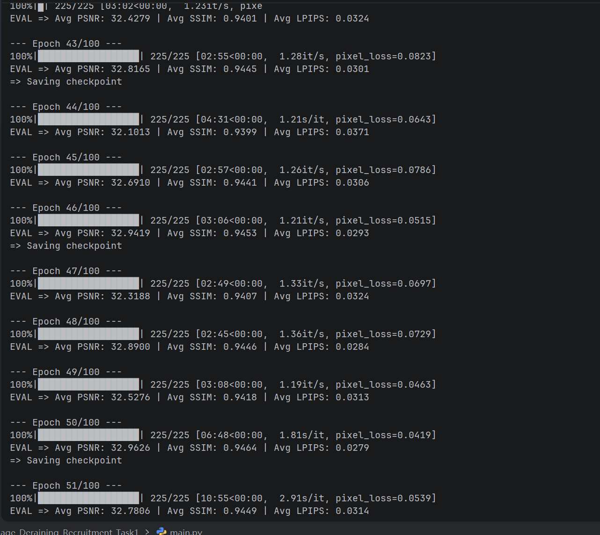
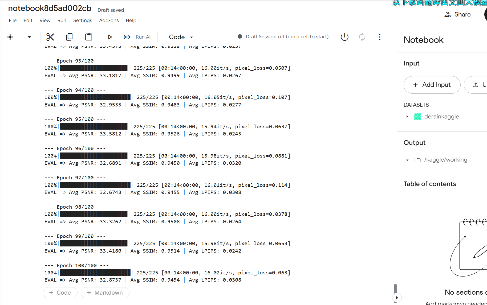

1. 
2. 
- 1
```python
import torch.nn as nn
import torch
class ResBlock(nn.Module):
    def __init__(self,in_channel,out_channel):
        super(ResBlock,self).__init__()
        self.conv1=nn.Conv2d(in_channel,out_channel,kernel_size=3,stride=1,padding=1)
        self.conv2=nn.Conv2d(out_channel,out_channel,kernel_size=3,stride=1,padding=1)
        self.relu=nn.ReLU()
    def forward(self,x):
            temp = x
            x = self.relu(self.conv1(x))
            x = self.conv2(x)
            x = x + temp
            x = self.relu(x)
            return x


class BaselineNet(nn.Module):
    def __init__(self):
        super(BaselineNet, self).__init__()
        self.conv1=nn.Conv2d(3,64,kernel_size=3,stride=1,padding=1)
        self.res_1=ResBlock(64, 64)
        self.res_2 = ResBlock(64, 64)
        self.res_3 = ResBlock(64, 64)
        self.conv2=nn.Conv2d(64,3,kernel_size=3,stride=1,padding=1)
        self.relu=nn.ReLU()
    def forward(self, x):
        frist=x
        x=self.relu(self.conv1(x))
        x = self.res_1(x)
        x = self.res_2(x)
        x = self.res_3(x)
        rain=self.conv2(x)
        result=frist-rain
        result=torch.clamp(result,0,1)
        return result
```
- 2（回来检查时二编）
   - 残差连接
   - derainnet里面的多尺度（不同分辨率下，任务分流）图像金字塔（把一份特征变成多份分辨率来并行看）
   - unet里面的上下采样（编码器一层层变小，再跳跃连接拼回）
   - 空洞卷积(卷积核里插空洞)
   - 大卷积核(成本upup)
   - 注意力机制（直接建立全局依赖）
3. 
- 1. 运行截图
不跑啦不跑啦我是cpu已经跑了3小时了才跑一半我真服了
！！！！！！！！！！！！！！！！！！！！！经过我和kaggle验证码显示不出来的问题折腾了好几天终于弄出来了，我也是用上cpu了
太爽了，20min结束

- 2. argparse 命令行参数笔记（学的代码是指命令行设置相关的吗...对于文件夹里面的其他题目未涉及的代码我也进行了研读，笔记在mynote）
1. 作用：让程序能通过"命令行"接收参数，不用每次改代码里写死的值
2. 创建解析器： `parser = argparse.ArgumentParser(description="Deraining Model Training")`
2. 加参数：      `parser.add_argument(...)`  （一个参数一行）
3. 解析打包：    `args = parser.parse_args()`   → 得到一个对象 args，用 `args.xxx` 取值(在mian.py的main的第一行)
4. add_argument 核心参数

| 参数 | 作用 | 例子 |
|------|------|------|
| 名字 | 命令行怎么叫它，`--xxx` | `"--model"` |
| type | 转成什么类型（str/int/float） | `type=str`, `type=int` |
| default | 不传时用的默认值 | `default="baseline"` |
| required | 必须传（True）否则报错 | `required=True` |
| choices | 只能选这几种，否则报错 | `choices=["baseline","unet"]` |
| help | 命令行 --help 时的说明文字 | `help="Model to use"` |
| action="store_true" | 开关型参数，传了就 True，不传就 False | `--use_perceptual_loss` |
5. 示例
gpu跑不动就要将batch_size变小喽.....nonono
```python
parser = argparse.ArgumentParser(description="Deraining Model Training")

# required=True：data_dir 必须给，不给直接报错
parser.add_argument("--data_dir", type=str, required=True, help="Path to the dataset")

# choices 限定--model 传的内容
parser.add_argument("--model", type=str, default="baseline",
                    choices=["baseline","unet","derainnet","mymodel"], help="Model to use")


parser.add_argument("--epochs", type=int, default=20)
# action="store_true"：开关，不传=False，传了=True
parser.add_argument("--use_perceptual_loss", action="store_true")
parser.add_argument("--use_easy_contrastive", action="store_true")
# 损失的权重
parser.add_argument("--lambda_perceptual", type=float, default=0.1)

# 随机种子（这是后面我自己加的）
parser.add_argument("--seed", type=int, default=42)

args = parser.parse_args()   
```
- 3. 已写在utils