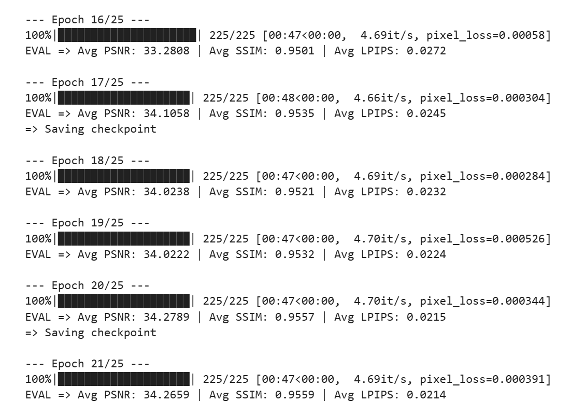

2. 下采样和上采样
- **下采样**（MaxPool）：取窗口里最大值，扔掉部分位置 → 图变小、信息压缩，so提取更抽象的深层特征，同时缩小图片尺寸减少计算量
- **上采样**（Upsample）：在像素之间插值补点 → 图变大、恢复分辨率.把深层特征图的尺寸放大，同时通过 “跳跃连接” 拼接下采样时保存的浅层高分辨率特征，恢复图片细节
3. 笔记
我太绝望了当时太懒不想写笔记我就说后面再来补，结果现在完全想不起来当时的探索过程了....
还看不懂自己写的了。我说里面怎么有个before rain后来才反应过来我把baseline的复制过来参考了一下
