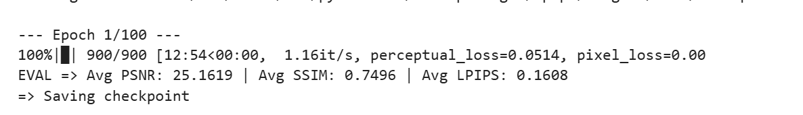
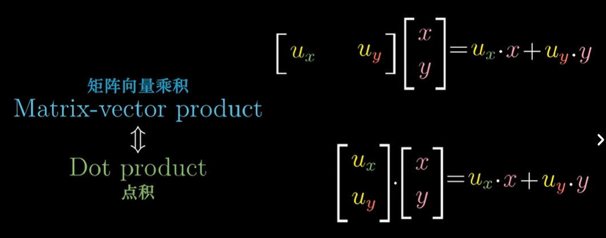

# 基于像素有什么不好
1. 
- 换了比较的坐标系 —— 从像素坐标换到感知特征坐标，特征图的像素对比不再是直接看每个像素一不一样，而是检查特征一不一样（比如只是平移了一点）
-  **多尺度**：浅层特征对应边缘/颜色，深层特征对应语义，加权后同时兼顾“局部纹理”和“整体语义”
2. 预训练网络的作用：作为特征编码器把图像从 "像素空间" 映射到 "感知特征空间"，提供了一个 "感知的度量标准"
3. 代码已补全，测试结果如下

可以调节系数，我这个设的0.1所以psnr不占主导，比较低
# 向量
1. what向量and维度？
- 有序的数字列表/空间中的箭头,既有大小又有方向的量
- 维度：向量里分量的个数 

2. 向量内积表示
- 代数形式：a · b = a₁b₁ + a₂b₂ + ... + aₙbₙ
- 几何形式：a · b = |a| · |b| · cosθ
> 在三角形中： |a − b|² = |a|² + |b|² − 2|a||b|cosθ   ← 余弦定理
而 |a − b|² = (a−b)·(a−b)= a·a + b·b − 2 a·b
> a·b = |a||b|cosθ   
3. 内积的意义
a·b = |a| × (b 在 a 上的投影长度)，给向量空间增加了“度量结构”
4. 余弦相似度
```
cosθ = a · b / ( |a| · |b| )
```
- if把两个向量**归一化成单位向量**后，`|a|=|b|=1`，so **`cosθ = a·b`**
