先总说一下，我读的是1和3,两篇文章的笔记放后面，这里先回答问题
2. 找文章的方法
- **从已知论文顺着找**：看**References** 和 **Related Work**
- **网站上关键词检索**：arXiv / Google Scholar 搜索
- **顶会文章**
- 看看博客啊知乎什么的，关注一下大佬的推特什么的
3. 英文看不懂
- ...............其实我还是看的中文，arxiv有双语对照，虽然有些翻得烂，但是大致意思可以get到，不知道的还可以回去看英文，还是要积累一点英文的邻域专有名词
- 浏览器自带的翻译其实还比较准，可以借助，小的单词也可以直接查
- 图片是精髓，感觉图片其实很多就能把网络展现清楚了，意会意会
- 如果b站上有大佬讲那将更棒了
4. 渐进式
- 把训练拆成**多个阶段**，**逐步增加难度**—— 先从简单（浅）的阶段开始训，逐步增加阶段数
- why 都用？深 / 复杂网络直接一步训，容易发散、难收敛，渐进式从简单开始更稳定、收敛更快、泛化更好
- 和出题人的训练方式的区别：一个是全程用固定配置训练同一模型，一步到位；一个是分阶段，每阶段逐步增加递归轮数
- 优:稳定、防发散、收敛快;劣：要设计阶段数、每阶段单独训练，代码更复杂
- 如果模型老是发散再使用，具体问题具体分析
- 以prenet为例（只是举例理解，不是原文啦）
训练时（渐进式调度）：
  epoch 0~10   → 只用前 2 次循环（T=2）反传
  epoch 11~20  → 用前 4 次循环（T=4）反传
  epoch 21~30  → 用满 6 次循环（T=6）反传
推理/测试时（固定结构）：
  永远用满 T=6 循环
5. 测试结果截图
我只跑了40epoch，因为kaggle没时间了..........
checkpoint在kaggle上，我搞了个zip复制下来
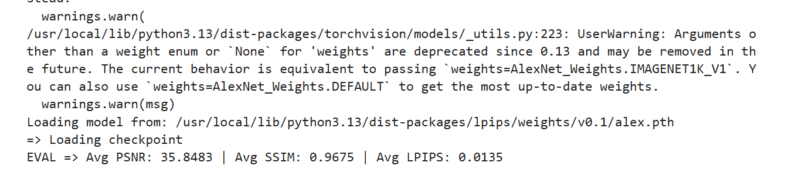
6. why同样架构反而降点
- 可能任务不一定完全一样？比如说论文3是针对超分的，直接融合的活可能有问题
- 原论文收益来自完整体系（多阶段监督、大数据、精细调参），只搬模块拿不到一样的，数据集我们的也是200张很少了
- 训练的batch都不一样，哎哟我的网络在kaggle上只能设为2，多一点都带不动，可恶啊

# Progressive Image Deraining Networks: A Better and Simpler Baseline
## 循环神经网络（RNN）
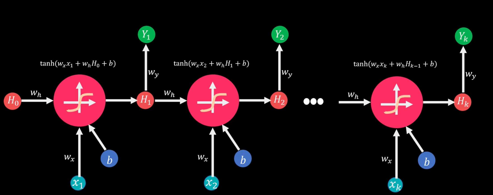
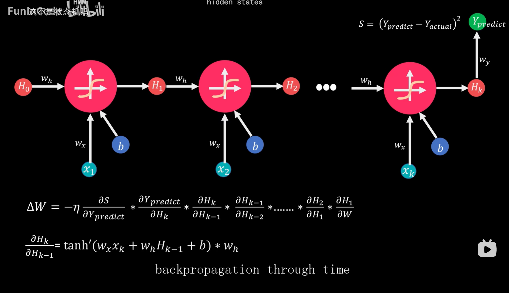
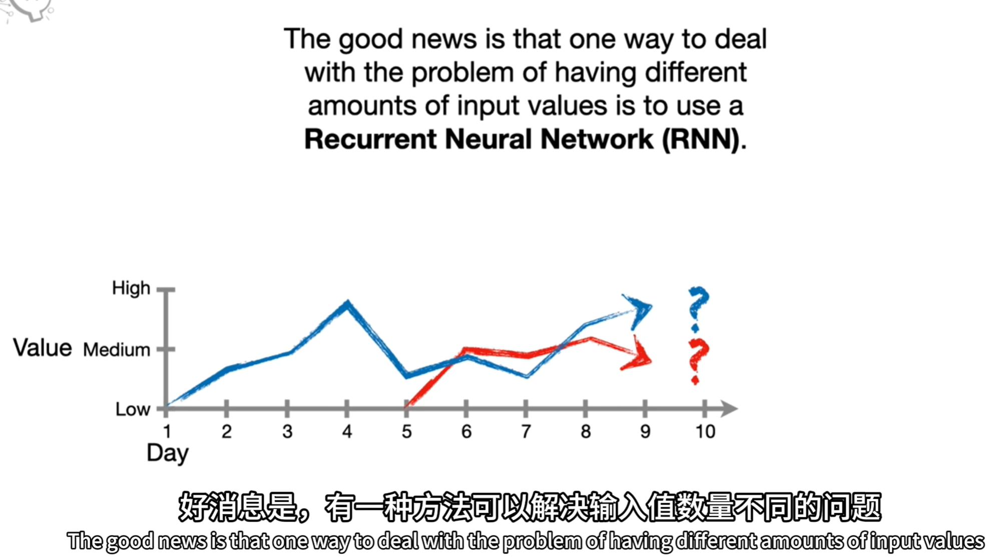
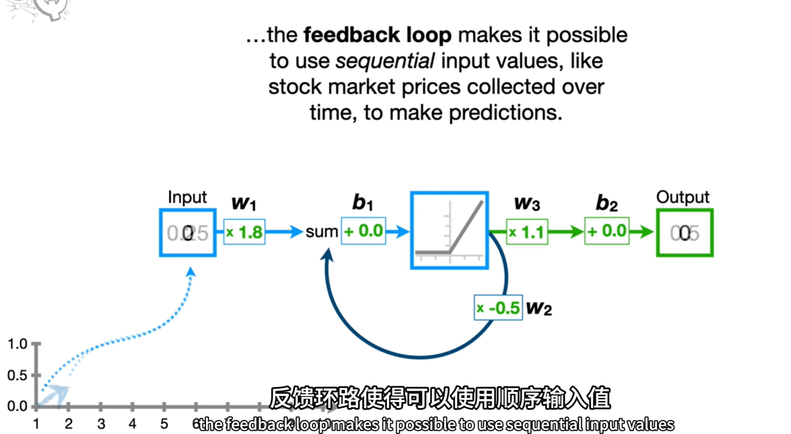
也有可能梯度消失或者爆炸
```python

```

## LSTM
LSTM 是长短期记忆网络，专门解决普通 RNN 在长序列中梯度消失的问题。

核心是 “记忆细胞”，像一个传送带，信息可以在上面流动而很少被修改，同时通过三个门控单元控制信息：遗忘门决定从记忆细胞中丢弃哪些信息，输入门决定哪些新信息存入记忆细胞，输出门决定当前输出什么值
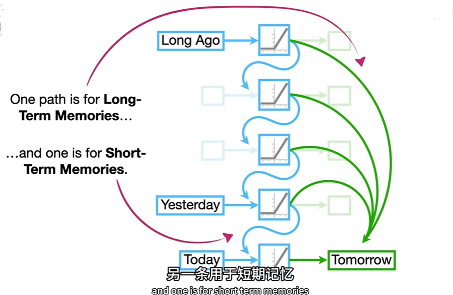
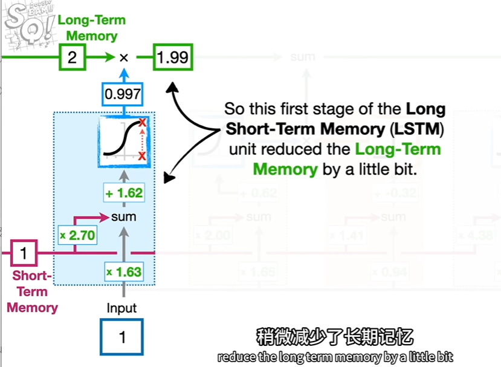
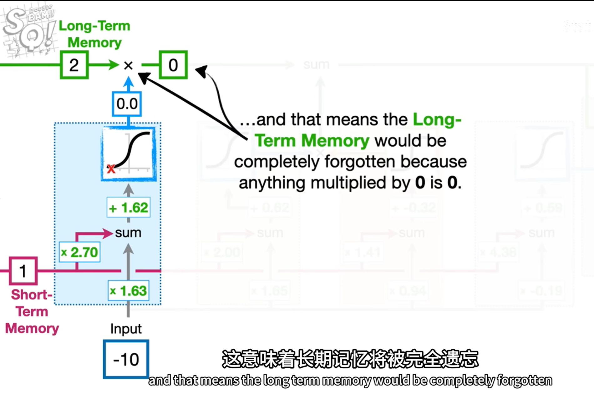
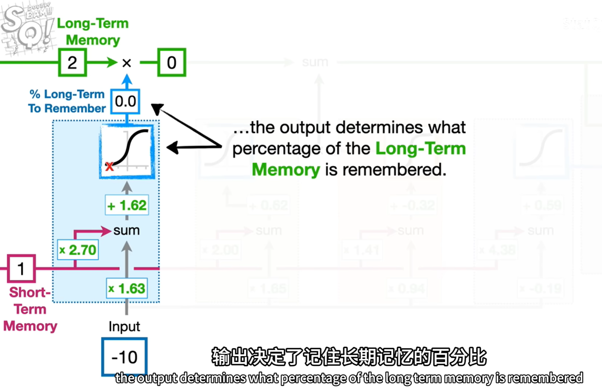
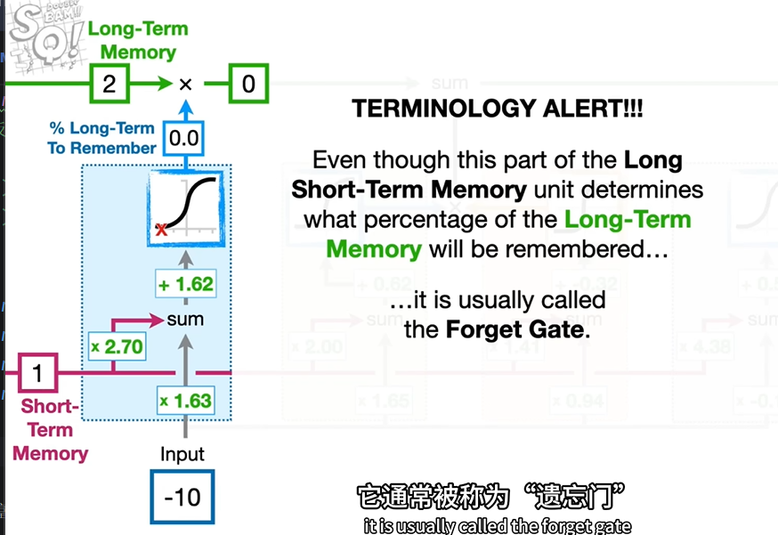
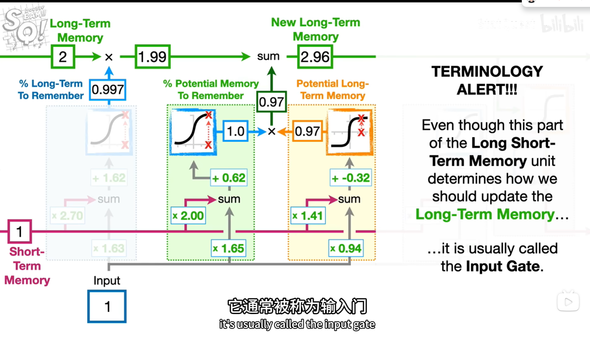
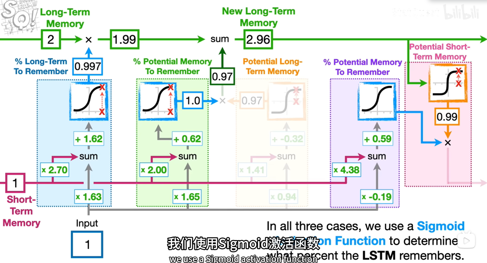
输出们
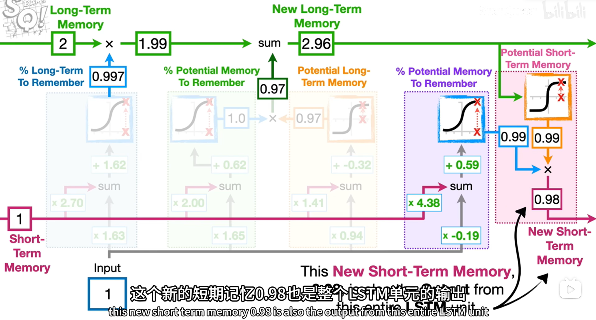
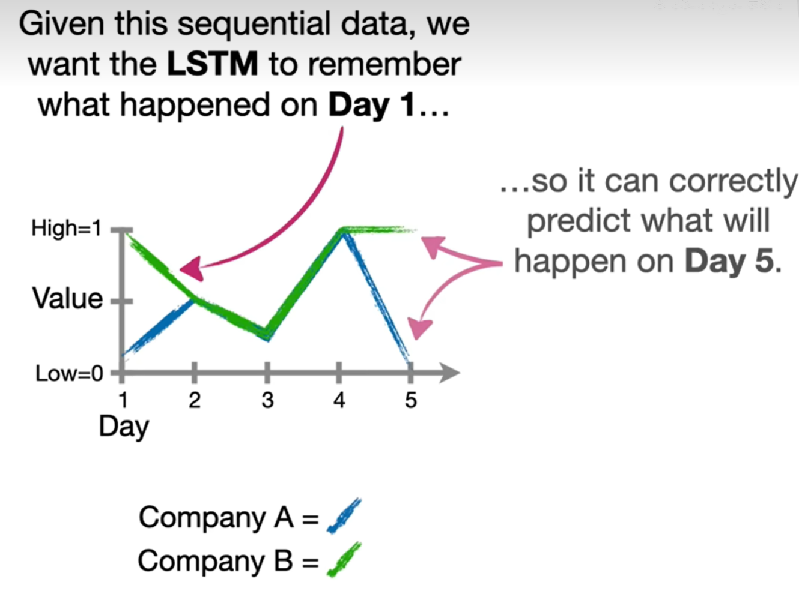
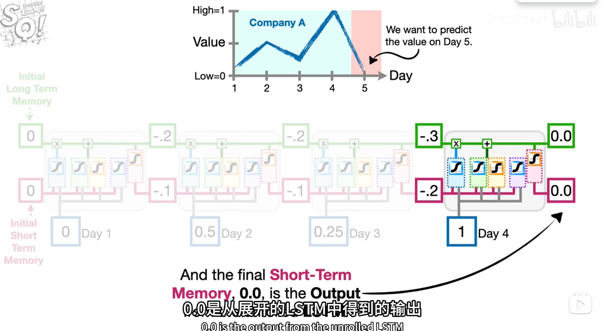
### 胞状态 `c`

- **长期记忆**
- 特点：改动缓慢，信息流动平滑
- 作用：一路带着历史信息，保存前面阶段学到的雨纹分布、图像轮廓

### 隐藏状态 `h`

- **当前时刻对外输出的特征 + 传给下一步的短时记忆**
- 来源：`h_cur = o * torch.tanh(c_cur)`
从细胞状态 `c` 提取一部分信息（由输出门 o 控制），包装成当前时间步的特征
```python
class LSTMCell(nn.Module):
    def __init__(self, input_size, hidden_size):
        super().__init__()
        # 四个门拼在一次线性层里，省计算
        self.W = nn.Linear(input_size + hidden_size, 4 * hidden_size)

    def forward(self, x_t, state):
        h_prev, c_prev = state
        combined = torch.cat([x_t, h_prev], dim=1)     # 输入和上一步h拼一起
        i, f, o, g = self.W(combined).chunk(4, dim=1)  
        i = torch.sigmoid(i)      # 输入门：0~1
        f = torch.sigmoid(f)      # 遗忘门：0~1
        o = torch.sigmoid(o)      # 输出门：0~1
        g = torch.tanh(g)         # 候选新信息
        c_t = f * c_prev + i * g  # 细胞状态：加法更新，梯度不容易消失
        h_t = o * torch.tanh(c_t) # 隐藏状态：由输出门决定吐出多少
        return h_t, c_t
    
class LSTM(nn.Module):
    def __init__(self, input_size, hidden_size):
        super().__init__()
        self.cell = LSTMCell(input_size, hidden_size)
        self.hidden_size = hidden_size
    def forward(self, x_seq):
        B, T, _ = x_seq.shape
        h = torch.zeros(B, self.hidden_size)
        c = torch.zeros(B, self.hidden_size)
        hiddens = []
        for t in range(T):
            h, c = self.cell(x_seq[:, t, :], (h, c))  
            hiddens.append(h) 
        return torch.stack(hiddens, dim=1)

```
## 其他
1. 在卷积中，当 stride=1 时，padding=kernel_size//2 能保证输出长宽和输入一致
2. 掩码：模型自动学习出来的 “哪里有雨就重点看哪里” 的指引图
3. 空间注意力模块会先 “判断” 每个空间位置的重要性，给雨纹区域更高的权重，让后续处理更关注这些关键区域，相当于给特征加了一层 “动态筛选”，针对性更强。

### 补充
ResNet的残差连接，本质也是在前向通路做特征相加；
而PRN（Partial Residual Networks，部分残差网络）修改残差结构，让**梯度流有多条通路**，反向传播时，把来自不同路径的梯度混合在一起，让每层参数接收更多样的梯度信息去更新，而不是单纯混合前向特征。
梯度组合不会增加网络的前向层，因此不会显著增加参数量和推理开销。


 


# MPRNet: Multi-Path Residual Network for Lightweight Image Super Resolution
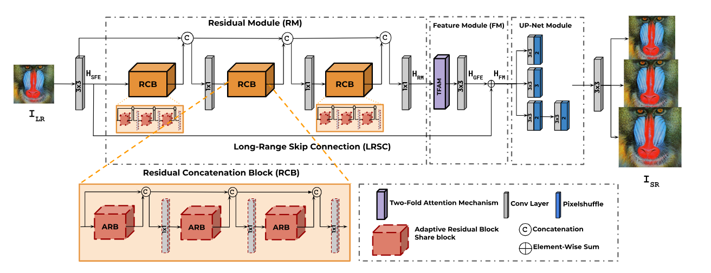


## 一些名词
1. 超分（图像超分辨率 Image Super-Resolution, SR）
输入一张低分辨率模糊小图（LR），算法预测放大后的高清大图（HR），**不仅仅是插值放大，而是 AI 生成原图不存在的纹理细节**。
2. 多路径并行分支
前面好像就让我们写了一个多路径并行，就是上下采样那里
3. SISR
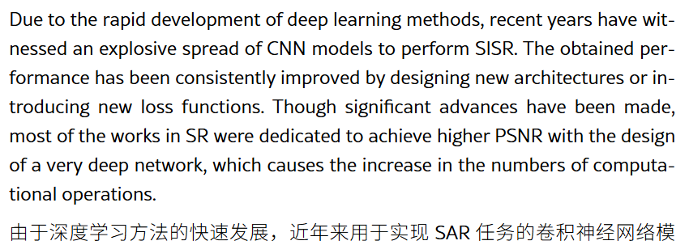
这网站自带的翻译怎么这么不靠谱，我还去查SAR是什么，原来原文是SISR，翻译不来的它都不知道恒等映射吗？？
- SISR = Single Image Super-Resolution，单图像超分辨率
3. 病态逆问题
- 一个 LR 像素对应着无数种可能的 HR 细节，**解不唯一**，所以called "病态"
- 放大倍数（up-scaling factor，如 ×2/×3/×4）越大，缺的细节越多、越难补，越容易补错
- 前面PReNet去雨里雨层和背景层混在一起，分离不唯一，同样是病态逆问题
4. Dw和Pw（和标准卷积比起来节省计算和参数，轻量的核心）
- **Depthwise Conv（Dw，深度卷积）**：对**每个输入通道各自**做一个 3×3 卷积，不跨通道混合。作用=提取**空间**信息，参数量只有标准卷积的约 1/C。
- **Pointwise Conv（Pw，逐点卷积 / 1×1）**：只看**单个位置**、在**通道维**上做线性组合。作用=融合/编码**通道间**信息，负责调整通道数。
> 组合 = 深度可分离卷积（MobileNet)：**Dw 管"空间长什么样"，Pw 管"通道怎么融合"**，分工明确还省参
> 标准卷积计算量≈Dw 计算量 × 输出通道数。for example 输入 C 通道、输出 C 通道，3×3 标准卷积计算量是 C×3×3×H×W×C，
> 而 Dw+Pw 的计算量是 C×3×3×H×W + C×1×1×H×W×C，当 C 较大时，Dw+Pw 的计算量远小于标准卷积，and that's拆分的意义
5. SOTA： “State Of The Art” 的缩写，指的是当前某个任务上性能最好的方法或模型。。。
## main贡献
1. *自适应残差块（Adaptive Residual Block, ARB）*：多路径残差，低成本提空间信息
2. *双重注意力（Two-Fold Attention Module, TFAM）*：同时看通道和空间，轻量通用 
3. *MPRNet 整体*：靠多级特征 + 多重残差连接把上面两个模块串起来


# 整体架构
> 每个模块后的1×1 卷积有什么作用？
- 拼接把通道数翻倍，1×1 卷积把通道数压回统一值，也**按通道融合**了各级特征
- 让每一层都能 "读到" 前面所有层的信息，能快速在整个网络传播
残差直接相加稀释信息，but拼接保留信息；相加的梯度要绕行，拼接的梯度是直通

1. SFE：就一个 3×3 卷积，把 RGB 的 LR 图映射到高维特征空间和PReNet 里 `f_in`一样
2. Residual Module
3. Feature Module：先用 **TFAM** 重新标定特征，再用一个全局提取器（GFE）提更抽象的特征，最后把 **LRSC（长距离跳跃连接）** 从 SFE 拿来的浅层信息直接加进来
4. UP-Net：特征空间用 PixelShuffle 放大（compared with先放大图像，省算力）


# Adaptive Residual Block（ARB）

##  ARB 的三条学习路径

每条路径**各提取一种信息**，最后汇合，让主干网络能同时拿到多种特征
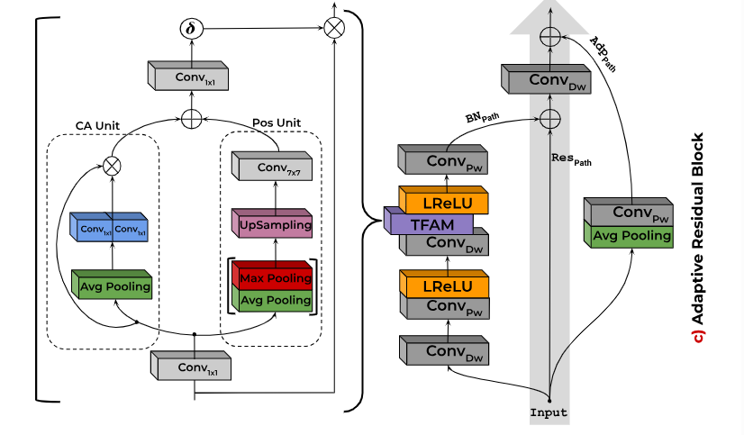
让ai画一个更清晰的流程图
```
                        Input x (B,C,H,W)
                              │
         ┌────────────────────┼────────────────────┐
         │                    │                    │
      BN Path              ResPath              Adp path
     ┌─────────┐          ┌────────┐          ┌─────────┐
     │①Conv_DW │          │ Conv   │          │ Conv_PW │
     │②Conv_PW │          │  1×1   │          │ Conv_PW │
     │③LReLU   │          └───┬────┘          │ AvgPool │
     │④Conv_DW │              │              └────┬────┘
     │⑤TFAM    │              │                   │
     │⑥LReLU   │              │                   │
     │⑦Conv_PW │              │                   │
     └────┬────┘              │                   │
          │                   │                   │
          └─────────┬─────────┘                   │
               ① ⊕ Res+BN 聚合                    │
                    │                              │
              补 Conv_DW 3×3                       │
                    │                              │
               ② ⊕ 最终聚合 ◄─────────────────────┘
                    │
                 Output
```
### 1. **Res 路径（残差路径）——"梯度好传"**
   - 把底层信息完整搬到高层，but它**刻意放在高维特征空间**上（compared wih MobileNet 放在窄瓶颈）
#### 1.1 whynot不用 MobileNetV2 的"倒残差瓶颈"

MobileNetV2 的倒残差结构（inverted residual + linear bottleneck）： 输入 → 1×1放大通道 → 3×3 Dw → 1×1压回窄瓶颈 → 残差短接
mobile 先变大再变小而普通的是先变小然后又变大
##### 1.1.1 ResNet Bottleneck：宽 → 窄 → 宽
eg.输入 256通道
1. 1×1：256 → 64（压缩）
2. **3×3卷积：在64通道上运算**
3. 1×1：64 → 256（还原）
> 把**最贵的3×3卷积，放在通道很小的瓶颈里面跑**第一步信息筛选的同时让第二步节省一点算力
- 如果直接在256通道做3×3：$9\times256\times256$
- 压缩到64之后做3×3：$9\times64\times64$ 
wa 3×3这一步的计算量直接降到原来的 1/16!!!!!!!!!!!!!!!!!!!!!
- 前后两个1×1卷积（$\(k=1\)$）用来做通道变换，成本低

##### 1.1.2 MobileNetV2 倒残差：窄 → 宽 → 窄
eg.输入 64通道
1. 1×1：64 → 192（扩张放大）
2. **DW 3×3卷积：在192宽通道上运算**
3. 1×1：192 → 64（压缩）

这里的3×3是 **Depthwise卷积**
DW卷积：**一个卷积核只负责一个通道，没有跨通道混合**
$$\text{DW-FLOPs} \approx H\times W \times k^2 \times C$$
- DW的计算量只和通道数**线性成正比**，没有 $C_{in}\times C_{out}$ 相乘项,哪怕通道upupup，算力负担也不大
- DW表达能力弱，通道太少学不出足够多空间模式，so**通道upupup，给DW足够多地盘提取空间特征**。
> Dw扩通道换取表达能力

##### 1.1.3 whynot
```
As can be seen, MobileNet-BottleneckBlock could not perform well in SR tasks due to difficulty of extracting high-frequency information and gradient confusion. 
```
对 SR 有缺陷：

- **信息丢失**：中间把特征**压到很窄的瓶颈**再放回去，压窄那一步会丢掉高频细节——而超分恰恰最需要高频。
- **梯度混乱（gradient confusion）**：残差短接挂在**窄特征空间**上，跨层梯度传播被削弱，网络难优化。
> 窄瓶颈（比如 16 通道）：要同时放下轮廓、高频细节、残差修正信号，全部塞一起。梯度在相加的时候，一个通道里面同时混着多种目标的更新信号，方向可能相反，互相抵消、互相拉扯。
> 梯度方向打架 → 参数不知道该往哪个方向更新，优化震荡、收敛变差。

> so **MobileNetV2 比较贴合分类的要求，but SR 要的是别丢高频，that's whynot**

### 2. **BN 路径（瓶颈路径）——"空间信息丰富"**
   - 用 Dw(3×3) 进入**高维特征空间**，编码更丰富的空间上下文；
   - 每个 Dw 后跟 Pw 融合通道、压计算；
   - 中途嵌 **TFAM**，把有用的通道/空间特征点亮（板块3 展开）；
   - 沿路径**保持通道数和分辨率不变**，避免中间突然涨计算。
### 3. **Adp 路径（自适应路径）——"抗噪、留重点"**
> 噪声是图像中随机出现的、和真实场景无关的像素点，让图像看起来模糊or不干净。如果输入有噪声，放大后噪声也会被放大
   - 用**全局平均池化（GAP）**把每个特征图压成平均值 → 平滑、去掉 LR 噪声、降维；
   - 再接 Pw(1×1) 保留重要信息；
   - 作用：让网络在**带噪的 LR 上依然稳健**，输出更锐利、细节更准

Adp 路径：`输入特征 → 全局平均池化(GAP) → 1×1 卷积 → (c,1,1) 全局描述符`
把整张特征图**聚合成一个全局统计量**，然后作为"干净的全局先验"去**调节**主路径。所以它去噪的方式是"**提供抗噪的全局信息**"，而不是"替主路径抹噪"。

#### 3.1 咦？平均为什么能去噪呢？
1. 假设特征图某个位置的值 = 真实信号 + 随机噪声：
```
 x(i) = s(i) + n(i)
```

- `s(i)`：真实信号（边缘、纹理）——**有结构、变化有规律**
- `n(i)`：噪声——**随机、有正有负、整体均值接近 0**
2. 对整张图做平均：
```
 mean(x) = mean(s) + mean(n)
```
！！！！！！！！！！！当噪声是**零均值随机噪声**，when把足够多个噪声加在一起平均，**正的和负的会相互抵消，mean(n) 逼近 0**

- 对**噪声**：平均 → 抵消 → 趋向 0（去掉啦）
- 对**信号**：平均 → 留下的是信号的"整体水平/DC 分量"（还活着）

```
 特征图 (c, h, w)  ── GAP ──►  (c, 1, 1)
                             每通道一个"全局均值"
```

> GAP 把**整个 H×W** 的平均成一个数，噪声被平均到接近 0，留下的是**每个通道的整体能量（均值）**
> although它丢失了**空间位置信息**，但**保留了"每个通道代表什么语义的强弱"**,we will remember your contribution

3. 随后怎么和另外两个融合滴？ ===>   1×1 卷积 + 广播聚合 = 全局偏置
   (1)咦？为什么1×1 卷积又是你？
      - 1×1 卷积通过学习权重，会给有效通道的均值分配大权重，给噪声通道分配小权重，这样融合出的 (C,1,1) 描述符，能更精准地对主特征进行全局偏置调节，让每个通道的所有空间位置都获得合适的基准偏移
      - 1×1 卷积是可学习线性变换，不只做加权筛选，还能学习跨通道差分，抵消公共固定偏移，校正被污染的全局统计量

4. *so 为什么这样能"去噪"*

- 主路径（BN（F（x））+Res（x））(残差融合 )保留的是**空间细节**——但ye**带着空间噪声**）。
- Adp 提供的是**不含噪声的全局均值**（因为噪声被平均抵消了），把它**加到每个位置上**，等于给主路径一个"**抗噪的基准值**"
- 于是主路径那些**被噪声带偏**的位置，会被这个"干净基准"往正确方向拉回一点.而真实的边缘信号因为偏差大、不会被基准淹没


# Two-Fold Attention Module（TFAM）
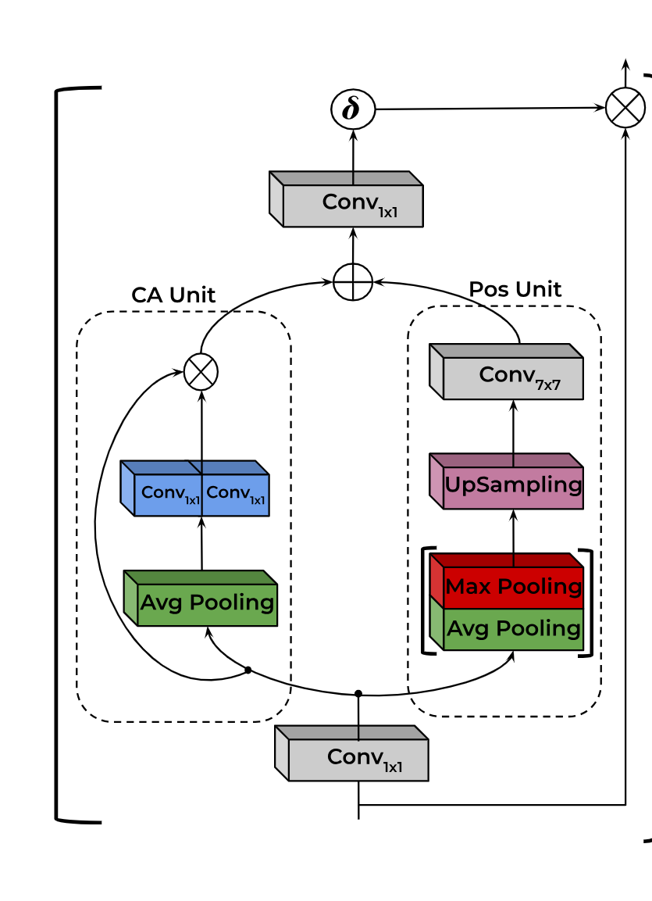
## 3.1 why需要"双重注意力"

残差块里的特征不是所有都值得保留=》注意力：**给特征图"打权重"，有用的lighter、没用的暗er**

- **通道维（channel）**：这一张特征图整体有没有用
- **空间维（spatial）**：这张图里哪个区域有用

> 边缘、纹理可能只出现在**某些通道**，也只落在**某些位置**。只做其一都会漏!!!!!!!!!所以 TFAM = **CA（通道） + Pos（空间）**，两个都学。

## 3.2 CA 通道
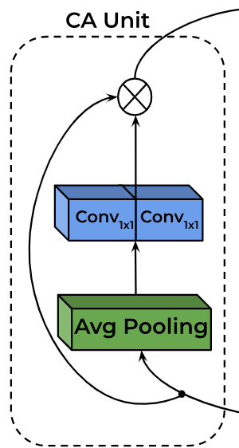
```
CA unit starts with an average pooling to exploit first-order statistics of features followed by two Conv layer, 
which they work side by side, each seeing half of the input channels,
and producing half the output channels, and both subsequently concatenated to even have more low-cost unit. 
```
依旧让ai模仿原图画一个更具体的流程图
```
 输入特征（C×H×W）
     │
     ▼
 全局平均池化 GAP ──► C×1×1   ← 一阶统计量（每个通道一个"平均能量"）
     │
     ▼
 ┌────────────────────────────┐
 │ 两组卷积【并排】，各看一半通道 │
 │ 组A: 输入一半C ─► 输出一半C    │
 │ 组B: 输入一半C ─► 输出一半C    │
 └────────────────────────────┘
     │ 拼接
     ▼
 通道注意力权重（"这张特征图要不要强调"）
```

- **平均池化**算"一阶统计量"——每个通道一个全局均值=>该通道的整体能量
- **两组卷积并排、每组只看一半通道**，再拼接=>**省参**

```
Unlike, MPRNet with CASR achieves better results than CBAM and SE because of considering both channel and spatial information but not better than ESA.
```
- CBAM 的**通道单元里用了 MaxPooling**，论可能会**丢失通道信息**——最大池化只保留最突出响应，把平均能量这种整体统计drop


*和 SE / ESA 的差距*：

- SE：只有通道，没空间
- ESA：强调空间，但"不突出通道里的重点特征"
- TFAM：**通道(一阶统计) + 空间(大核Avg+Max) 两路都做足**，所以最全

## 3.3 Pos Unit 
```
 Pos unit requires a large receptive field to work perfectly in SR tasks unlike the classification task. 
 Thus, Average- and Max pooling operations with a large kernel size have been employed and then concatenated them to generate an efficient feature descriptor.
  afterward, an UpSampling layer is used to retrieve the spatial dimensions, which is followed by a Conv layer to generate a spatial attention map.
```
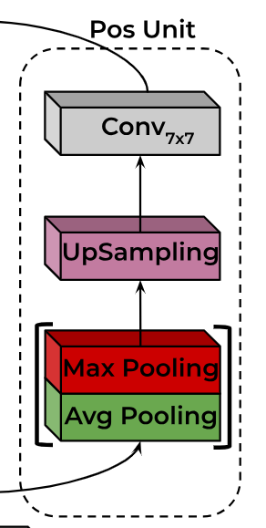

```
 输入特征（C×H×W）
     │
     ▼
 大核 Avg池化 ──┐
               ├── 按通道拼接
 大核 Max池化 ──┘
     │
     ▼
 上采样（恢复 H×W 空间尺寸）
     │
     ▼
 卷积 ──► 空间注意力图
```

- why**大核**？超分要看大范围结构，感受野小了抓不住重要区域在哪。分类任务小核够，超分不行。
- 为什么 **Avg + Max 一起**？Avg 看"整体亮度"，Max 看"最突出响应"，两者互补，拼起来描述更全面呀
- 上采样把压缩过的空间尺寸**还原**，再卷积生成逐位置的注意力图。

## 3.4 我们意念合一

```
 CA权重（通道） ╮
              ├─ 聚合 ─► 1×1 Conv（恢复通道维）─► sigmoid ─► 最终注意力掩码
 Pos权重（空间） ╯
                                    │
                                    ▼
                          与 HR 特征做残差连接 ──► 输出
```

- sigmoid 把权重压到 (0,1)，乘回特征；**残差连接**把高质量 HR 特征直接带到模块末端，保证注意力增强的同时不丢原始信息。
- 咦？为什么还要做残差连接？
> 所有特征都被**缩放衰减**，权重永远 ≤1.有用的特征只能被保留一部分， 原始特征本身的信息上限被压低.极端情况 mask 接近 0，直接把特征抹掉。
> 若加上残差`feat + feat * mask = feat * (1 + mask)`： 原始特征原样直通，注意力分支只做**增强增益**，而不是筛选压制，就不会破坏原始基础特征啦

## 3.6 与 PReNet 
RESCAN 用的是 SE 注意力（只通道、平均池化）。TFAM 是它的plus把空间这一维也补上，且 CA 用分组卷积更省。


# 4. 残差连接：LRC / GRC / LRSC
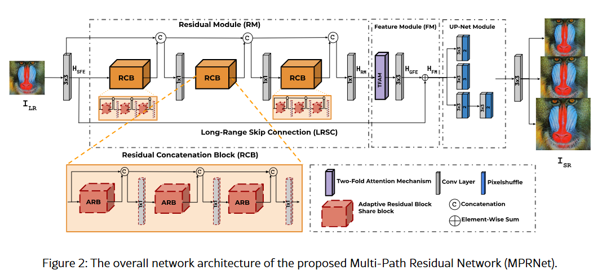
1. 直觉上"连接越直、越短，信息传得越稳"——可消融表里，**只加 LRC（最短的局部连接）反而比什么都不加还略差**。最短的连接怎么会帮倒忙？坑藏在哪一步？
2. 三种连接按跨越距离排：**LRC < GRC < LRSC**。为什么最远的那条 LRSC 反而最"稳"、最不可或缺？

1. **LRC**（局部）  RCB **内部**：ARB 之间  多个 ARB 输出**拼接 + 1×1** 短距离把每级的细特征聚起来 
2. **GRC**（全局） RM **内部**：RCB 之间 收集所有 RCB 输出 + 1×1  中距离，进入下一模块前汇总多级表示 
3.  **LRSC**（长距离）  **SFE → FM 输出**（跳过整个 RM）：把未处理的浅层原始信息送到高层，缓解梯度消失 


```
On the contrary, MPRNet with only LRC inside Residual Concatenation Block could not perform better than the MPRNet with GRC. This behavior was expected as mentioned in [11] that 1
× 1 Conv layer on the residual connection can confuse optimization and prevent information propagation due to multiplicative manipulations. 
```
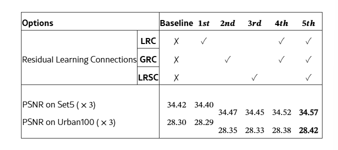
1. 只加 LRC 反而掉分？！
   - LRC 有 **1×1 卷积**（拼接后再融合通道）
   - Identity Mappings in Deep Residual Networks（[11]）：残差短接**最好保持恒等映射（identity）**；一旦在短接路径上放卷积做乘法/线性变换，就会**干扰恒等映射**，反向传播的梯度会"打折扣"，信息传播受阻
   - so LRC 单独用时，那层 1×1 反而不妙
2. **GRC 单独用就比 Baseline 好？？**
   - **在模块级别**收集 RCB 的所有多级信息，让模型在进下一个模块前"看全"各级特征，收益盖过了 1×1 的副作用
3. **LRSC 单独用略好**——最短最直的"恒等"跳跃（直接相加，无卷积干扰），把浅层原始信息稳稳送到高层，是最干净的一条
4. **4th（LRC+GRC）> 只加任一个**GRC 
   - 恰好**缓解了 LRC 的局部信息传播问题**，两者互补。
5. **全用（5th）best**——LRC 管块内、GRC 管块间、LRSC 管全局，**三条长短互补 + 梯度多路可走**，梯度消失被压到最低，网络能同时拿到"细、中、粗"多级表示

>**LRC 局部、GRC 模块汇总、LRSC 全局**

## 4.4  PReNet

PReNet：靠 **ConvLSTM 隐状态 s^t** 跨阶段传递"记忆"——这是**时间轴**上的信息传递。
*MPRNet*：靠 **LRC/GRC/LRSC** 显式残差连接传信息——这是**结构轴**上的"短路"。

> 
> all for **让深层特征和梯度别"迷路"**。PReNet 用循环记忆记住前面阶段，MPRNet 用跳跃连前面模块


2. LRSC 用的是"直接相加"，LRC 用的是"拼接+1×1"——同样是连接，为什么 LRSC 不拼接？拼接会带来什么额外成本？（提示：拼接翻倍通道，1×1 又得融合回去，恒等性被破坏）


##  上采样 


SISR 网络采样位置：预上采样，后上采样，渐进式
MPRNet 选后上采样： **几乎全部计算都发生在低分辨率特征上**，H×W 小，算力、显存都省——轻量plus


# 两个论文融合
我先初步进行了简单的融合拼接，就是将原本的res_5板块换成rm,然后再加上lrsc
不知道这样直接拼的效果如何，我让ai给我提了一点建议并再次进行了修改


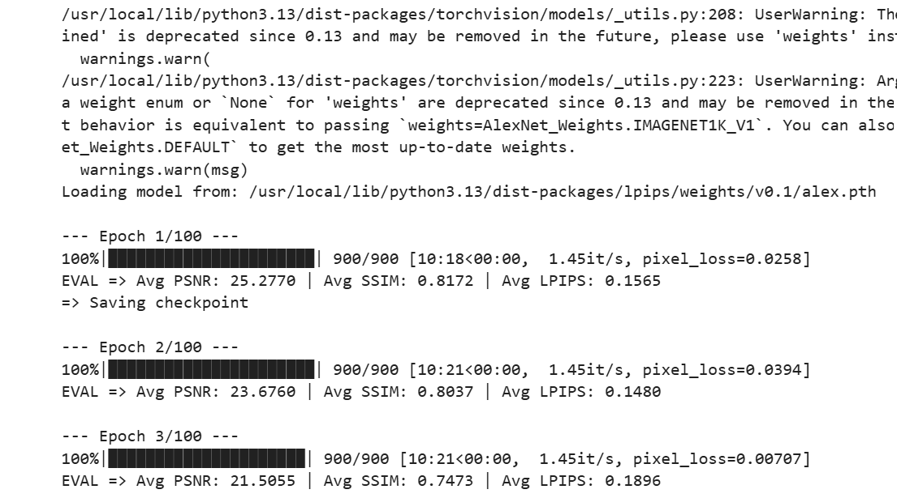
跑的结果一点都不好，和前面的模型比起来差远了，真服了，还要跑这么久，而且越跑越差

数据传入的顺序可能有影响，我突发奇想想在我的cpu电脑上跑一下，第一个epoch跑了3个小时psnr是33比这个强多了，

我觉得应该是我没有设随机种子，而这种复杂一点的数据传的顺序什么的不一样影响会很大，

但是会差这么多么，也许是我上传kaggle的文件和本地有差距是之前的半成品？？我忘了

反正现在正常了

还有一点就是我在kaggle上只能batchsize=2,因为大一点都跑不走，可能这点maybe有影响
我还没完全研究懂kaggle为什么我开了session还是会弹出问我在不在然后就把我的关了，所以下面图片是前几epoch，还是在稳步上升的

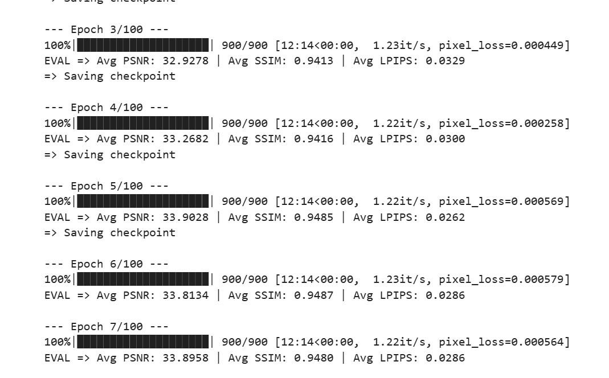


# ONNX 核心基础（以下为面向导出学习）
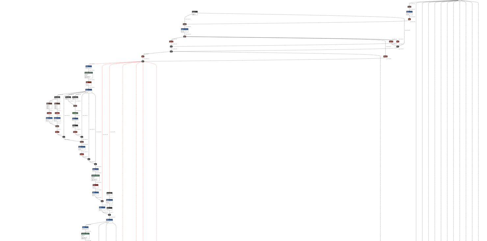
## 1.1 whatONNX 
ONNX = Open Neural Network Exchange，开放神经网络交换格式，是**一套统一的计算图描述标准 + 存储文件格式**
- PyTorch、TF 这些训练框架有自己内部的计算图===》导出 ONNX 就是把框架里的前向计算逻辑，翻译成 ONNX 标准的图，存成 `.onnx` 文件
```
ModelProto
└── GraphProto  # 核心计算图，导出出来的主体
    ├─ Node      # 算子节点（Conv, ReLU, Add, Sigmoid, Interpolate...）
    ├─ Tensor    # 常量张量，也就是权重、偏置
    └─ ValueInfo # 输入、输出、中间张量的信息：名字、shape、数据类型
```

## 1.2 how导出
1.  opset_version（算子集合版本）
  - 图像CV网络（ResNet、去雨网络）常用：13 ~ 17。
2.  trace / script（导出捕获模式） 
   1. **torch.jit.trace（追踪模式）** 开
  - 给一条dummy输入，**实际跑一遍模型前向**，跟着执行轨迹记录计算图。
>只是**无法捕捉依赖输入的动态控制流**,
比如：`if x.max()>0: ... else:...`、动态循环..............
只会记录dummy输入走的那一条分支，另一条分支直接drop啦
   2. **torch.jit.script（脚本编译模式）**
  - 支持动态分支，but语法限制很大

2. dynamic_axes 动态维度 & symbolic shape（符号维度） 开
默认trace导出是**静态shape**：dummy输入多大，导出后输入就固定多大

so一般需要
- dynamic_axes：用来标记哪些维度是**动态可变**的，动态batch、H、W什么的（我感觉大部分情景都会用到吧）
- symbolic shape：用字符串符号代替固定数字，比如 `batch`、`h`、`w`

```python
dynamic_axes = {
    "input": {0: "batch", 2: "h", 3: "w"},
    "output": {0: "batch", 2: "h", 3: "w"},
}
```
输入的第0维是batch可变，2、3维高宽可变

3. do_constant_folding 常量折叠 开
图化简优化，导出时提前把能算死的常量运算直接算完，变成Tensor，减少Node数量
如模型里有 `x = torch.ones(3,3) * 2 + 1`，but我觉得这种还是挺少的
4. 校验工具
- `onnx.checker.check_model(model)`：ONNX官方校验器，检查图语法、算子、shape定义合不合法，非法直接抛异常
- onnxsim（onnx-simplifier）：第三方化简工具
    很多时候torch导出出来会带一大堆冗余算子、Identity（数据搬运）、Cast（数据类型转换器），虽然checker不报错，但后端容易炸；onnxsim做图化简、消除冗余，是CV导出标配。
- Netron：可视化工具，加载onnx


# ONNX Demo
## 2.1 函数原型
```python
torch.onnx.export(
    model,
    args,
    f,
    export_params=True,
    opset_version=None,
    do_constant_folding=True,
    input_names=None,
    output_names=None,
    dynamic_axes=None,
    verbose=False,
)
```
### 参数
1. **model**
    待导出模型。强制要求：`model.eval()`
2. **args**
    dummy 假输入，trace 会拿着这个输入跑一遍前向，记录计算流
    - 单输入：直接传 tensor
    - 多输入：写成 tuple `(inp1, inp2)`
3. **f**
    输出文件，字符串路径 `"model.onnx"`
4. **export_params=True** 开
    是否把权重、bias 打包进 onnx 文件
    - True：带权重，就是我们要的成品模型 most!!!!
    - False：只导出计算图结构，不带参数
5. **opset_version**
    算子版本，CV 图像网络 `13~17`
6. **do_constant_folding=True** 开
    常量折叠优化，把可以预先算好的常量运算合并，减少节点，图更简洁(默认打开)
7. **input_names / output_names**
    给输入、输出张量起名字（字符串列表）
    好处：Netron 里面好认，后面对接后端的时候可以按名字取输入输出。
    示例：`input_names=["input"], output_names=["output"]`
8. **dynamic_axes**  开
    动态维度配置字典，静态导出时填 `None`
9. **verbose=False**
    设为 True 会打印导出过程的算子日志，排错的时候开！！！！！！！

> 重点：`torch.onnx.export` 默认底层使用 **trace** 模式。

## 2.2 Demo：dynamic_axes 动态维度导出
dynamic_axes 语法：
```python
dynamic_axes = {
    "输入名字": {维度下标: "符号名"},
    "输出名字": {维度下标: "符号名"},
}
```
示例：动态 batch + 动态高宽
```python
import torch
import onnx
from onnxsim import simplify

class SimpleNet(torch.nn.Module):
      #略

model = SimpleNet()
model.eval()

dummy_input = torch.randn(1, 3, 256, 256, dtype=torch.float32)

dynamic_axes = {
    "input":  {0: "batch", 2: "height", 3: "width"},
    "output": {0: "batch", 2: "height", 3: "width"}
}

torch.onnx.export(
    model=model,
    args=dummy_input,
    f="dynamic_net.onnx",
    export_params=True,
    opset_version=16,
    do_constant_folding=True,
    input_names=["input"],
    output_names=["output"],
    dynamic_axes=dynamic_axes,
    verbose=False
)

# 校验+化简
onnx_model = onnx.load("dynamic_net.onnx")
onnx.checker.check_model(onnx_model)
model_simplified, check_ok = simplify(onnx_model)
assert check_ok
onnx.save(model_simplified, "dynamic_net_simplified.onnx")
print("动态维度导出完成")
```
Netron 打开后输入 shape 会变成：`["batch", 3, "height", "width"]`，batch、高宽都可以变

## 2.3 多输入 / 多输出写法
if你的网络不止一个输入或者返回多个输出
```python
# 多输入：args传元组
dummy_in1 = torch.randn(1,3,256,256)
dummy_in2 = torch.randn(1,1,256,256)
torch.onnx.export(
    model,
    args=(dummy_in1, dummy_in2),
    f="multi_in.onnx",
    input_names=["x1", "x2"],
    output_names=["out1", "out2"],
    ...
)
```


## 逐个优化点（为什么 + 怎么改，保留你的命名风格）

下面每个都给出可直接粘进你文件的改动，**变量名沿用你现在的习惯**。

### 🥇 优化点 1：输出层零初始化（收益最大，几乎零成本）

**为什么**：你的网络是残差预测（`y - rain`）。如果 `f_out` 随机初始化，第一轮就会输出一个随机的"雨层"，训练要从"乱改图"学起。**把它全零初始化**，一开始 `rain ≈ 0 → x = y`，网络从"什么都不改"出发，再慢慢学该怎么去雨——收敛更稳。这是所有残差去雨网络（含 PReNet 官方）的标准做法。

在 `Mymodel.__init__` 末尾加：
```python
# 输出层零初始化：初始时雨层≈0，即 x=y 恒等，训练从"不改图"开始（残差网络技巧）
nn.init.zeros_(self.f_out.weight)
nn.init.zeros_(self.f_out.bias)
```

### 🥇 优化点 2：TFAM 的"近恒等初始化"

**为什么**：TFAM 的作用是"微调"特征，不是"大改"。如果你随机初始化它的 `fuse` 卷积，一开始 attention 就会乱加权，干扰主干特征。把它初始化成**近似恒等映射**：`sigmoid(fuse(bias=-4)) ≈ sigmoid(-4) ≈ 0.018`，这样一开始 `mask ≈ 0`，`x + x*mask ≈ x`，TFAM 几乎不起作用，训练稳定后再让网络自己决定注意力。这是标答 L113-115 的核心。

在你的 `TwoFoldAttention.__init__` 加：
```python
# 近恒等初始化：初始 mask≈sigmoid(-4)≈0.018，模块近似恒等，训练更稳
nn.init.zeros_(self.fuse.weight)
nn.init.constant_(self.fuse.bias, -4.0)
```

### 🥇 优化点 3：Adp 路径加可学习缩放 `delta`

**为什么**：你的 `adp_path`（全局平均池化 → 1×1）如果直接 `+ adp` 加进主特征，一开始就会强加一个"平滑过的全局信号"，可能干扰。标答加了个 `delta = nn.Parameter(torch.zeros(1))`，从 **0** 开始学——**一开始 Adp 路径完全不起作用，训练过程中网络自己决定它贡献多少**。这避免了"强塞一个可能有害的路径"。这也呼应你上一轮该思考的"Adp 去雨适配性"问题：让网络自己学 δ，比硬加更安全。

在 `ARB.__init__` 加：
```python
self.delta = nn.Parameter(torch.zeros(1))   # Adp 路径可学习缩放，从 0 学起
```
`ARB.forward` 改成：
```python
h = self.dw_agg(h + x)              # Res(恒等) + BN 聚合后补 Dw
h = h + self.delta * self.adp_path(x)  # Adp 路径，先缩放再加
return self.pw_agg(h)
```

### 🥈 优化点 4：Pos 空间注意力改成"降分辨率大感受野"

**为什么**：你现在用 k=7 大核池化保持尺寸，感受野也就 7×7。标答的做法是：**先把空间描述子压到 1/8 分辨率，做 7×7 卷积（此时等效感受野大得多），再双线性上采样回原尺寸**。这样能"看到更远的雨纹/上下文"，正好命中去雨"需要长距离依赖"的需求。

参考标答 L85-102，可改成（保留你 PosUnit 的命名）：
```python
def forward(self, x):
    b, c, h, w = x.shape
    ph, pw = max(1, h // 8), max(1, w // 8)
    desc = torch.cat([x.mean(dim=1, keepdim=True), x.amax(dim=1, keepdim=True)], dim=1)
    desc = F.adaptive_avg_pool2d(desc, (ph, pw))          # 压到低分辨率
    att = self.conv(desc)                                  # 7×7 卷积（小图上=大感受野）
    att = F.interpolate(att, size=(h, w), mode="bilinear", align_corners=False)
    return torch.sigmoid(att)
```

## 四、还有一个"结构选择"帮你决策：通道数 & 规模

- 标答 small = `stages=6, ch=32, n_rcb=3, n_arb=2` ≈ **0.24M**。
- 你现在 = `T=6, ch=64, n_rcb=3, n_arb=3` ≈ **0.6M**。 

题干只要求 ≤4M，所以你 0.6M 达标。但**训练速度**（你之前 CPU 吃过 3 小时的亏）是另一回事。建议先用标答 small 规模（ch=32、n_arb=2）跑通、看指标，确认融合有效后再考虑放大。**先用轻的验证思路，再往重里加，是调模型的最优顺序。**

---

## 五、给你留一个"引导式确认"（改之前先想清楚）

标答把 Adp 路径做成了 `delta` 从 0 学起、TFAM 近恒等、输出层零初始化——这三个都是"**先让网络从保守的起点学，再逐步放开**"的思路。

**你觉得这是为什么？**（提示：你的网络是"残差预测" `y - r`，如果一开始这些模块就随机大改特征，会发生什么？和"先从不改图学起"比，哪个更容易收敛？）

想清楚这一条，你就抓住了标答"精华中的精华"——不是结构多花哨，而是**训练稳定性**。
