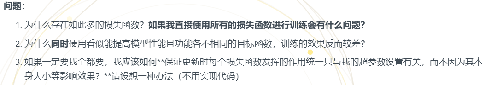

1. 为什么存在如此多的损失函数？如果我直接使用所有的损失函数进行训练会有什么问题？
- 因为要结合任务和需求从不同角度给模型打分，（eg.L1/L2 管像素精度，感知损失管人眼观感，对抗损失管真实感，对比损失管特征结构)
- 
   - 同时用不同损失的量级不同，量级大的占主导导致数值尺度淹没 
   - 而且每个损失想要的优化方向不同，梯度左右为难啊
   - 每个损失有自己的最优点，联合最优是折中，任何单一指标都可能比单损失时更差
（我试着用新写的两个损失时就遇到了）
2. 为什么同时使用看似能提高模型性能且功能各不相同的目标函数，训练的效果反而较差？
  - 正是因为互补所以本身就有冲突，比如psnr高的可能纹理就没那么清楚，和上面提到的最优点不同是一样的
3. 归一化
- 打印的输出来看每个损失的波动还是不大，所以或许可以大概取一个值来转换，但是这样好像也不太精准，每个loss下降的速度不一样...
- 最好是可以跟着变emmmmm， 此时想到刚刚看的moco里的动量更新含的滑动平均，或许可以这样设一个改变的值，设一个比较大的β，防止我loss跳的时候不跟着乱跳
θ_k ← m · θ_k + (1−m) · θ_q   
