问题
1. 对比学习的特征
- 有道理，我的编码器是预训练好的，只有一个负样本
- 特征
- 编码器,正样本对,负样本对(大量), 自监督，目标是拉近正样本，推开负样本
- 通常不直接优化下游任务（如分类），而是通过一个“代理任务”（如实例判别）来学习通用的特征表示
- 常用损失函数：InfoNCE Loss是最常用的对比损失
2.
anchor（锚点） = derained
正样本 = clean
负样本 = rainy
3. 
我选择了第一个，写成infoNCE,在easy-contractive


讲解笔记
# moco
# 背景知识
1. 无监督表示学习
- 输入：大量无标签图片
- 输出：一个好的特征提取器 f(x)，把图片映射成有意义的向量
- 用法：特征提取器可以直接拿去做下游任务，只需要在少量带标签数据上微调

2. why cv邻域很难
- NLP：语言任务有离散的信号空间（word / sub-word token），
     可以天然地构建"token 字典"
- CV：图像是连续的、高维的信号，没有天然的"token"

2. **对比学习（Contrastive Learning）**
核心思想：让"相似的样本"在特征空间里靠近，"不相似的样本"远离。

举例：同一个人的不同角度（正面样本）→ 特征向量要接近
      不同生物（负面样本）→ 特征向量要远离
# introduction
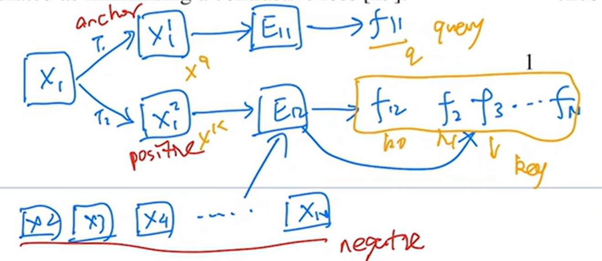
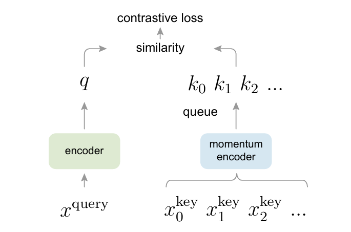

```
From this perspective, we hypothesize that it is desirable
to build dictionaries that are: (i) large and (ii) consistent
as they evolve during training.
```
1. 理想字典条件
- 大：更好地采样底层的连续高维视觉空间，负面样本越多，对比学习学到的特征越好，能学到更细粒度、更有判别力的特征
- 一致：字典中的 key 应该由相同或相似的编码器来表示，这样它们与 query 的比较才是一致的（负样本使用的编码器各不相同，可能选出负样本中与它使用相同编码器的）
1. 问题与解决方法
- 问题 ：字典要大，但受 batch size 和显存限制 ==> 解法：队列
> 把过去 N 个 batch 的 key 都存起来，  新的进，老的出，字典大小 = 队列长度 K ,与 batch size 完全解耦
- 问题 ：队列里不同时刻的 key，编码器不一样 ==>解法：动量更新 
> key 编码器 f_k 的参数不直接反向传播更新，  而是 query 编码器 f_q 的滑动平均： θ_k ← m·θ_k + (1-m)·θ_q  （m = 0.999，变化极慢） → key 编码器基本一致
# related work
1. MoCo 是机制而不是任务,聚焦于损失函数一侧，可以套在不同前置任务上
2. 损失函数
- 第一类：**重建 / 分类损失**—— 目标是固定的，不随训练变化
- 第二类：**对比损失**—— 目标不是固定的，是动态生成的样本对（比如实例判别，每次迭代正负样本都在变）
- 第三类：**对抗损失**——GAN
1. 前置任务
```
- 1：像素级重建
  - 去噪自编码器：输入带噪图 → 输出干净图
  - 上下文自编码器：输入缺失区域 → 补全
  - 颜色化（colorization）：输入灰度图 → 输出彩色图

流派 2：单图变换生成伪标签
  - Exemplar 网络：同一张图的不同增广 = 同一类
  - Jigsaw（拼图）：打乱 patches 顺序 → 预测原始位置
  - Rotation（旋转）：旋转图像 → 预测旋转角度

流派 3：对比学习类前置任务
  - Instance Discrimination：同图两次裁剪 = 正样本对（we use this)
  - Contrastive Predictive Coding (CPC)：上下文预测
  - Contrastive Multiview Coding (CMC)：多视图对比
```
3. 代理任务的作用就是去生成一个自监督的信号，从而去充当ground truth这个标签信息
# method
## infoNCE
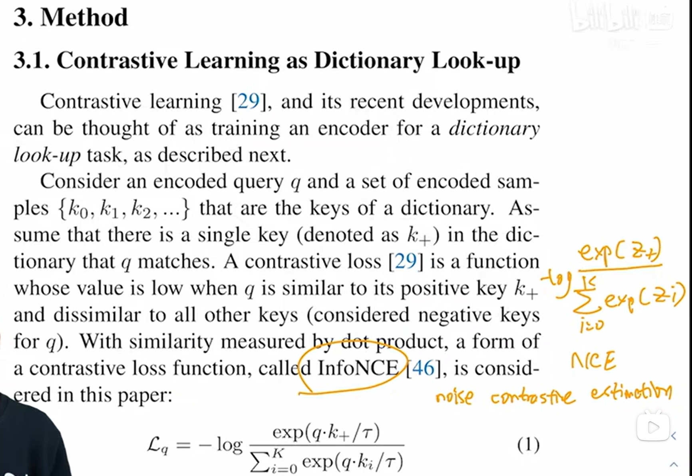
只取一部分负样本来做计算，队列就是我们采样出来的这一批负样本
NCE 的核心思想：不用全部噪声，**采样一批噪声当作负样本，就可以近似原始的概率估计**。只要负样本足够多、采样合理，这个近似是有效的![[Pasted image 20261025151645.png]]
从计算示例可以看出模型分得很清楚，正样本相似度远高于负样本
- 温度系数的作用
τ 越小 → softmax 越"尖锐"→ 只关心最难的负样本
τ 越大 → softmax 越"平滑"→ 所有负样本一视同仁

MoCo 用 τ=0.07，是一个比较小的值,so模型专注搞定最难区分的样本
## 三种机制的对比
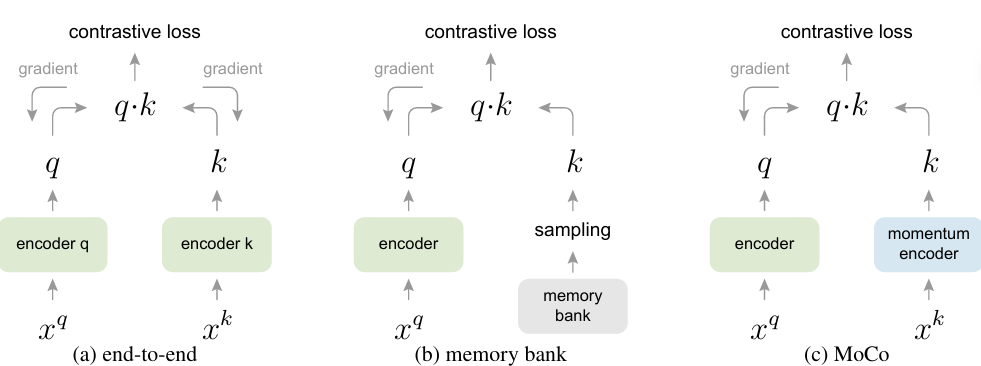
- a:两个编码器都反向传播更新，梯度从 q·k 流回两边.key 由同一个 batch 的样本编码 ,一致性好（两个编码器同步更新), 但字典大小 = batch size（受显存限制）
- b:k ← 从 memory bank 里随机采样（不经过编码器), memory bank 存着所有样本的特征向量 ,只有 encoder_q 反向传播. 字典可以很大（存整个数据集的特征),但 key 是历史时刻编码的，编码器已经变了 → 一致性差（不同时刻的 key 来自不同版本的编码器）
### 动量更新

```
Using a queue can make the dictionary large, but it also makes it intractable to update the key encoder by back-propagation (the gradient should propagate to all samples in the queue). A naive solution is to copy the key encoder f_k from the query encoder f_q, ignoring this gradient. But this solution yields poor results in experiments (Sec. 4.1). We hypothesize that such failure is caused by the rapidly changing encoder that reduces the key representations' consistency.
```

1. 如果每一步都直接把 f_k = f_q（复制参数），这一步的 key 编码器和 query 编码器是完全一样的，但上一步的 key 编码器和 query 编码器不一样（ query 更新了）， 队列里同时存在新编码器编码的 key和旧编码器编码的 key不一致
2. 所以用动量更新并且把动量系数设置的很大，这样key编码器相对来说变化很缓慢，保证了一致性
### 伪代码
  ```python
# f_q, f_k: encoder networks for query and key
# queue: dictionary as a queue of K keys (C×K)
# m: momentum
# t: temperature

f_k.params = f_q.params   # 初始化：key 编码器 = query 编码器（参数复制）

for x in loader:          # 加载一个包含 N 个样本的 mini-batch
    x_q = aug(x)          # 随机增广得到 query 视图
    x_k = aug(x)          # 另一次随机增广得到 key 视图

    q = f_q.forward(x_q) # queries: N×C
    k = f_k.forward(x_k) # keys: N×C
    k = k.detach()        # 不计算 key 的梯度（key 不走反向传播）

    # positive logits: N×1正样本
    l_pos = bmm(q.view(N,1,C), k.view(N,C,1))

    # negative logits: N×K负样本
    l_neg = mm(q.view(N,C), queue.view(C,K))

    # logits: N×(1+K)
    logits = cat([l_pos, l_neg], dim=1)

    # contrastive loss, Eqn.(1)
    labels = zeros(N)    # 正样本是第 0 个（因为 logits 第 0 列是 l_pos）
    loss = CrossEntropyLoss(logits/t, labels)

    # SGD update: query network
    loss.backward()
    update(f_q.params)    # 只有 query 编码器走反向传播

    # momentum update: key network
    f_k.params = m*f_k.params + (1-m)*f_q.params

    # update dictionary
    enqueue(queue, k)     # 把当前 batch 的 key 入队
    dequeue(queue)        # 把最老的 batch 出队
```
# 对比学习串讲
  
1、百花齐放

**Unsupervised Feature Learning via Non-Parametric Instance Discrimination**
**InstDisc（instance discrimination）**

这篇论文提出了个体判别任务以及memory bank

  
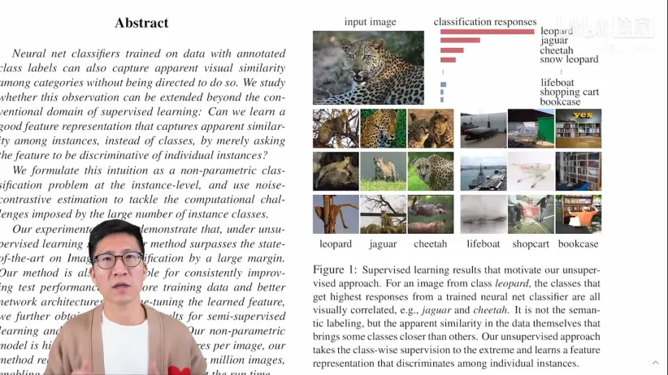
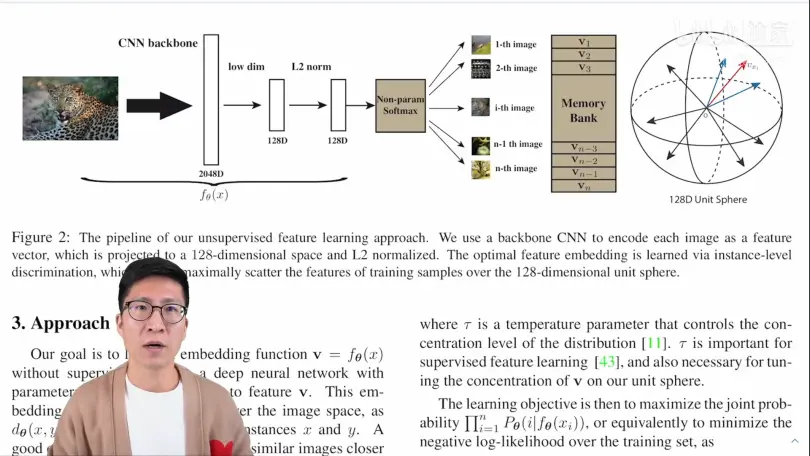
- 通过一个卷积神经网络把所有的图片都编码成一个特征（让这些特征在最后的特征空间里能够尽可能的分开，因为对于个体判别任务来说每个图片都是自己的类，所以说每个图片都应该和别的图片尽量的分开）
- **Memory Bank**（记忆库）：每个样本 \(x_i\) 对应一个长期特征向量 \(V_i\)，每次用当前网络算完新特征后，用 _动量平滑_ 的方式更新 \(V_i\)
-  proximal regularization：给模型的训练加了一个约束，从而能让 memory bank 里的那些特征进行动量式的更新，跟 MoCo 的想法接近
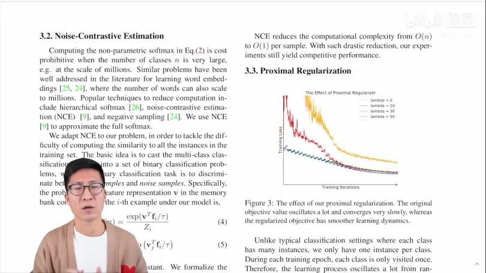

  

  

**Unsupervised Embedding Learning via Invariant and Spreading Instance Feature**
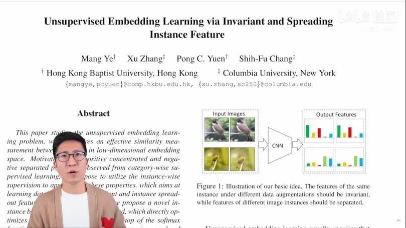
  

~ SimCLR 的一个前身，没有使用额外的数据结构去存储大量的负样本，它的正负样本就是来自于同一个 minibatch，而且它只用一个编码器进行端到端的学习

- 对于相似的图片、相似的物体，特征应该保持不变性，但是对于不相似的物体或者完全不沾边的物体，特征应该尽可能的分散开

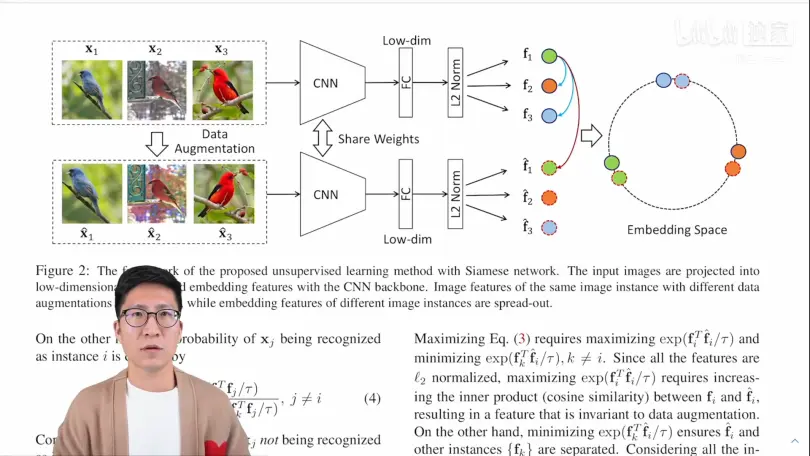
- 代理任务也是选取了个体判别这个任务

前向过程：

- 从同一个 mini-batch 里去选正负样本=>可以用一个编码器做端到端的训练了，这也就是MoCo里讲过的端到端的学习方式
- 本文所用的目标函数也是 NCE loss 的一个变体
哈哈哈哈哈哈，没有TPU，笑死我了，果然搞研究还是需要经济支持啊...................
  

  

**Representation Learning with Contrastive Predictive Coding**

  

**CPC(**contrastive predictive coding)

  

一般机器学习分为判别式模型和生成式模型
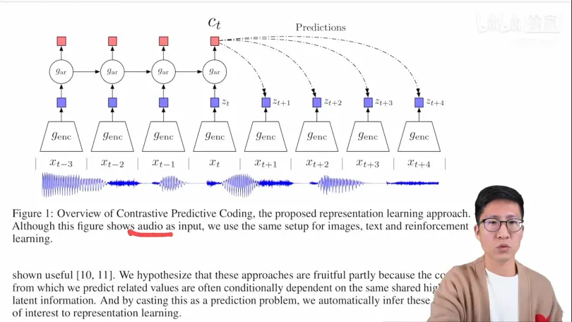
- CPC不仅可以处理音频，还可以处理图片、文字以及在强化学习里使用
- 假如说有一个输入 x（一个持续的序列），t表示当前时刻，t-i表示过去的时刻，t+i表示未来的时刻。把之前时刻的输入全都扔给一个编码器，这个编码器就会返回一些特征，然后把这些特征喂给一个自回归的模型，得到图中红色的方块（ct，context representation，代表上下文的一个特征表示），如果这个上下文的特征表示足够好,包含了当前和之前所有的这些信息，那它应该可以做出一些合理的预测，就可以用ct预测未来时刻的这个zt +1、zt + 2（未来时刻的特征输出）
- 为什么 CPC 预测未来特征 z，而不直接预测原始信号 x？
>像素 / 波形 x，模型容易学局部、低频、表层的插值规律；预测高层特征 z，逼着模型抓取结构性、语义上的依赖
- 对比学习:正样本是未来的输入通过编码器以后得到的未来时刻的特征输出，相当于做的预测是 query；负样本可以任意选取输入通过这个编码器得到输出，都应该跟预测是不相似的

  

**Contrastive Multiview Coding**

  

**CMC(**contrastive multiview coding**)**

  一个物体的很多个视角都可以被当做正样本
- cmc工作的目的就是去增大互信息（所有的视角之间的互信息）
- 学到一种特征能够抓住所有视角下的关键的因素
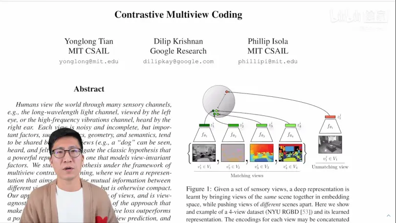
- cmc原班作者人马用对比学习的思想做了一篇蒸馏的工作：不论用什么网络，不论这个网络是好是坏是大是小，只要你的输入是同一张图片，那得到的这个特征就应该尽可能的类似，也就意味着想让 teacher 模型的输出跟 student 模型的输出尽可能的相似，通过这种方式把 teacher和student做成了一个正样本对，从而可以做对比学习
- 局限性：处理不同的视角或者说不同的模态时候，可能需要不同的编码器，因为不同的输入可能长得很不一样


**2、CV双雄**
**Momentum Contrast for Unsupervised Visual Representation Learning**

**MoCo**
MoCo 的主要贡献
- 把之前对比学习的一些方法都归纳总结成了一个字典查询的问题

- 队列
- 动量编码器

MoCo跟Inst Disc非常相似

- 用队列取代了原来的memory bank作为一个额外的数据结构去存储负样本
- 用动量编码器去取代了原来loss里的约束项，达到动量的更新编码器的目的
  

**A Simple Framework for Contrastive Learning of Visual Representations**

  

**SimCLR(simple contrastive learning)**
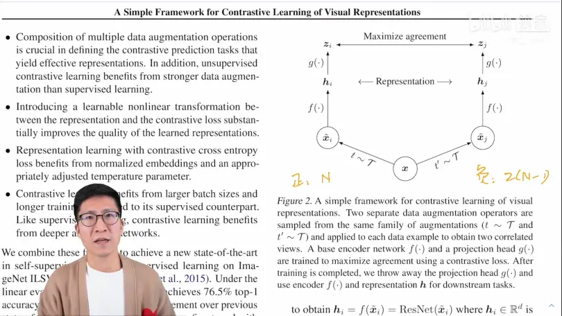
- 有了正负样本之后通过编码器f对它进行编码，两f是共享权重
- 创新点：在特征之后又加了一个projector，上图中的g函数，一个mlp层（只有一个全连接层，后面跟一个 relu 的激活函数）
- 直接在 h 空间做对比，模型会把对下游任务有用的信息抹掉，表征 h 质量变差；加一个非线性的 projection head g，把对比学习的压力转移到 z 空间，保护 h
- g函数只有在训练的时候才用，而在做下游任务的时候，把g函数扔掉，只用h这个特征去做下游任务

  SimCLR跟Inva Spread的区别

- 更多的数据增强
- g函数
- 更大的batch size
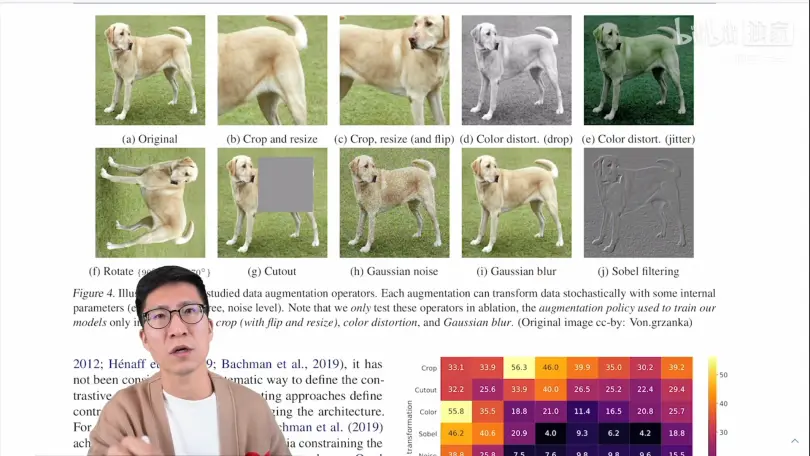
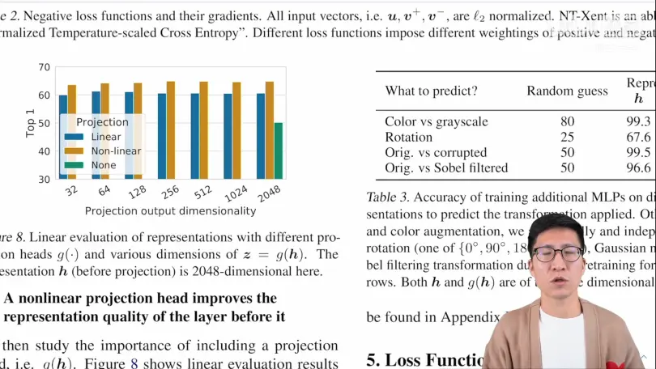

**Improved Baselines With Momentum Contrastive Learning**
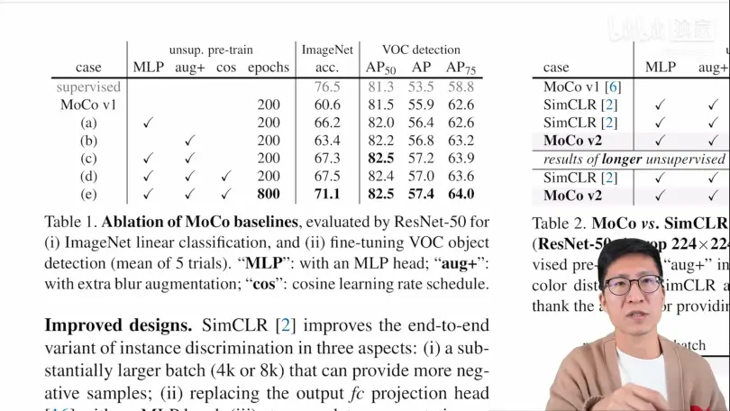
- 加了一个 mlp 层
- 加了更多的数据增强
- 训练的时候用了cosine的learning rate schedule
- 训练更长的 epoch，从200变到了800
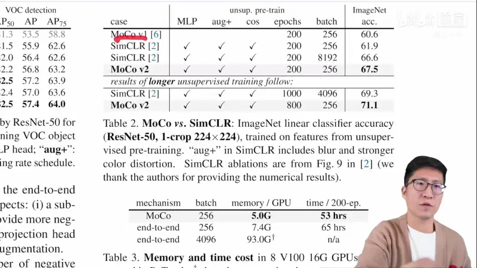
  

**Big Self-Supervised Models are Strong Semi-Supervised Learners**

  

**SimCLR v2**

  非常大的自监督训练出来的模型非常适合去做半监督学习
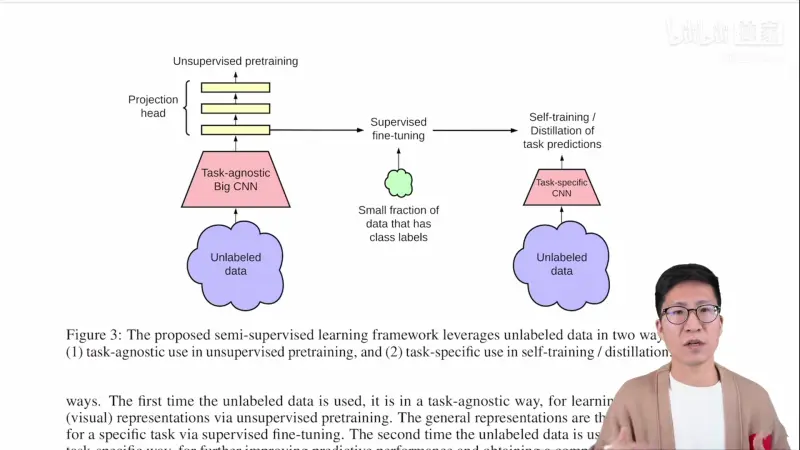

- 更大的模型
- 原来是 fc + relu，现在是 fc + relu fc + relu，一层变成两层的 mlp，加深了这个projection head
- 使用动量编码器

  
**Unsupervised Learning of Visual Features by Contrasting Cluster Assignment**


**SwAV**

给定同样一张图片，希望可以用一个视角得到的特征去预测另外一个视角得到的特征
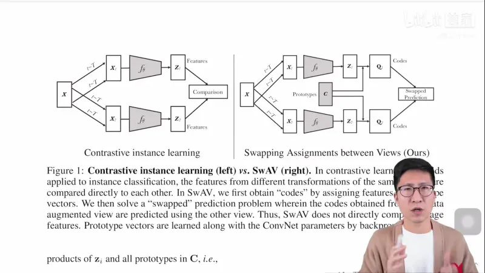

1. 原图 x 做两次增强，得到 𝑥1,𝑥2，送入同一个编码器 𝑓𝜃，输出特征 𝑧1,𝑧2
2. 拿 𝑧1 和全部原型C做点积相似度，做分配，得到 code 𝑄1 拿 𝑧2 和全部原型C做点积相似度，得到 code 𝑄2
> 𝑄 不是特征向量z了，它是一个分布标签：代表这个视图被分到哪一个原型（聚类）

3. Swapped Prediction（交换预测）
- 用 𝑧1 去预测 𝑄2
- 用 𝑧2 去预测 𝑄1
> SwAV does not directly compare image features.  对比学习是 z₁ ↔ z₂ 匹配； SwAV 是 z₁ 去猜“z₂属于哪个聚类code”、z₂去猜“z₁属于哪个聚类code”。


聚类的好处

- 如果跟很多的负样本类比，可能就需要成千上万的负样本，而且即使如此也只是一个近似，而如果只是跟聚类中心做对比，则可以用几百或者最多3,000个聚类中心
- 聚类中心有明确的语意含义，之前随机抽样抽取负样本去做对比的话，负样本有的可能还是正样的，而且有的时候抽出来的负样本类别也不均衡 
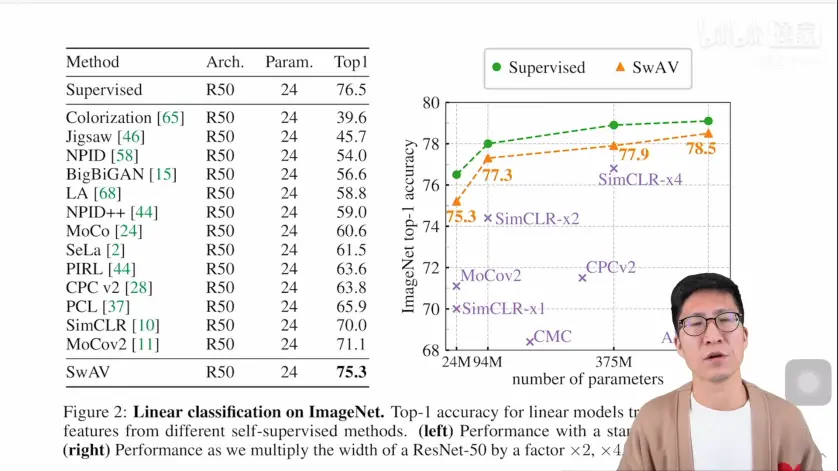
- 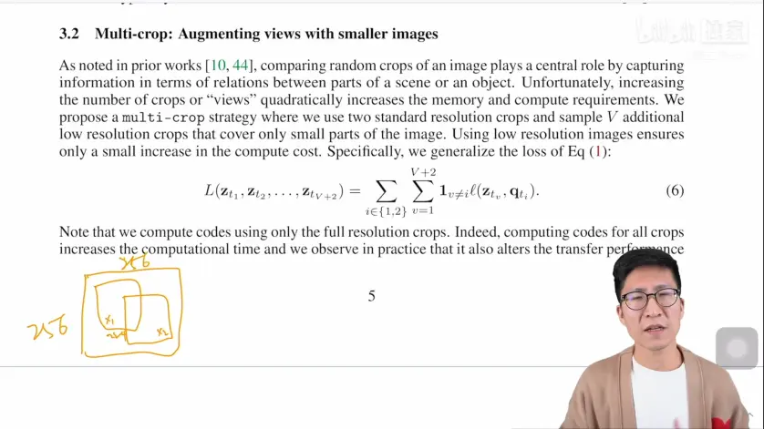

multi crop:

- how同时使用更多的正样本，而又不增加太多的计算成本？
>原来是取了两个224*224的crop，现在把这个crop变成160 ，即取2个160的crop去争取学全局的特征，然后为了增加正样本的数量学一些局部的特征，再随机选4个小一点crop（96*96），这样的话现在有6个视角了（正样本的数量增多了，但是通过取舍，整体的计算代价差不多）
- 对其它的对比学习的方法也有用
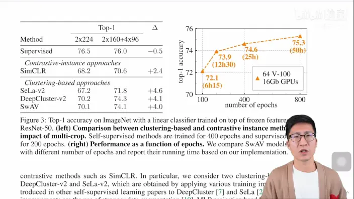

What Makes for Good Views for Contrastive Learning

- InfoMin的原则：最小化互信息minimi mutual information：想要不多不少的互信息，如果最大化互信息以后比所需要的互信息要多，也是一种浪费，而且有可能泛化做的不好，但如果互信息比所需求的这个互信息要少，有可能达不到最优的性能
**3. 无负样本**
BYOL
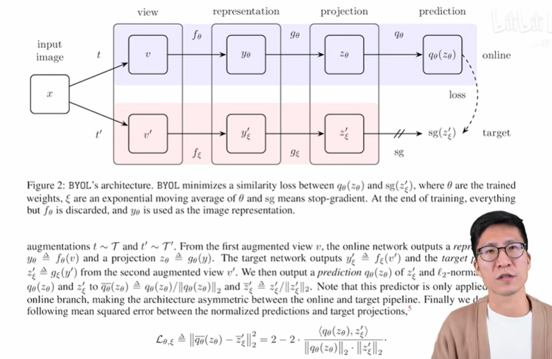
  - SwAV：特征→原型分配得到 code，预测的是**离散聚类标签**
- BYOL：直接预测**连续向量**，没有原型、没有聚类，回归式匹配
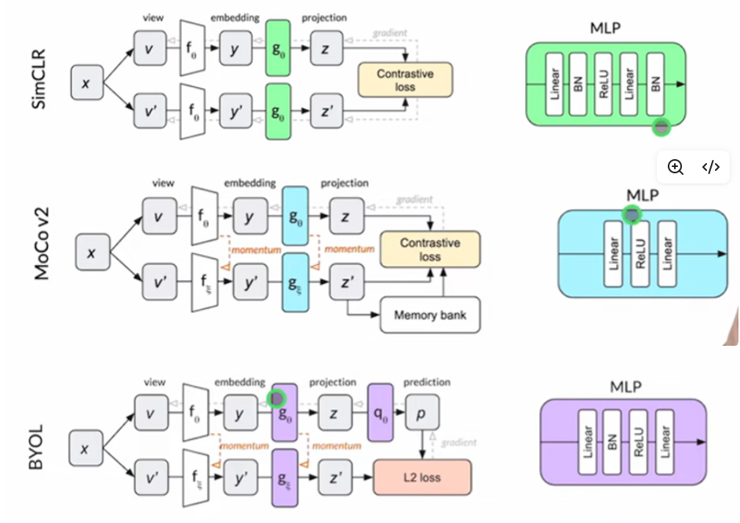
BN中可能存在数据泄露，相当于可以把这个batch里面的其他样本想成隐式的负样本![[Pasted image 20261026112442.png]]
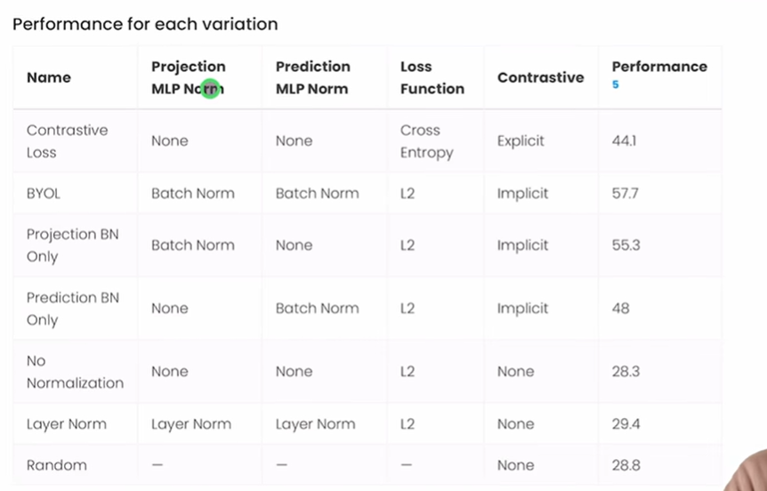
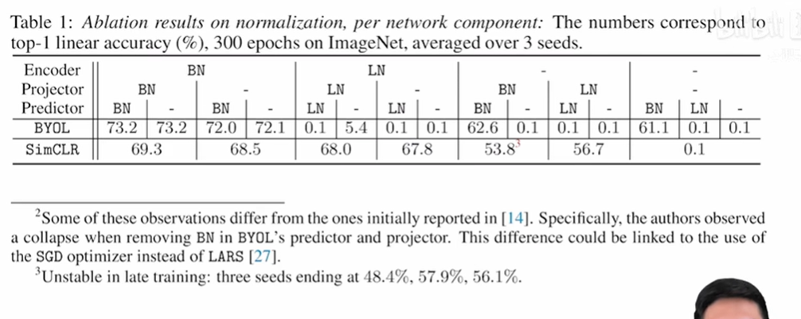
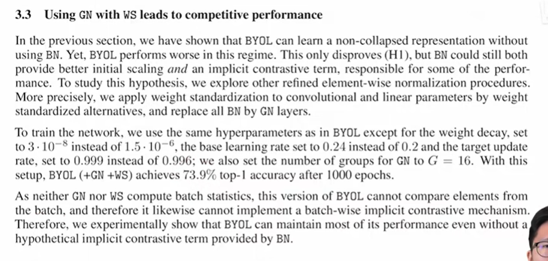
作者回应用GN和WS也行，这两种没有可能存在泄露的处理，难绷的故事
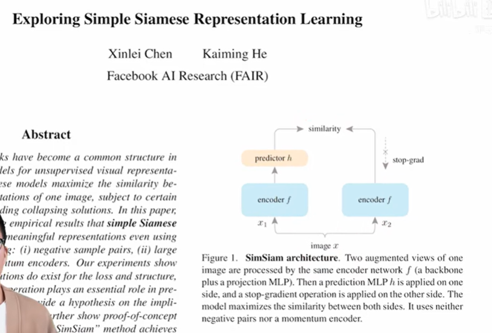
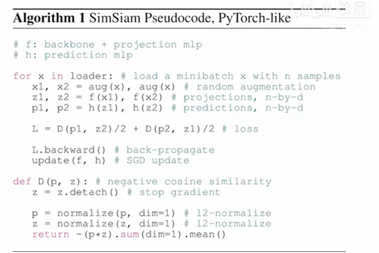
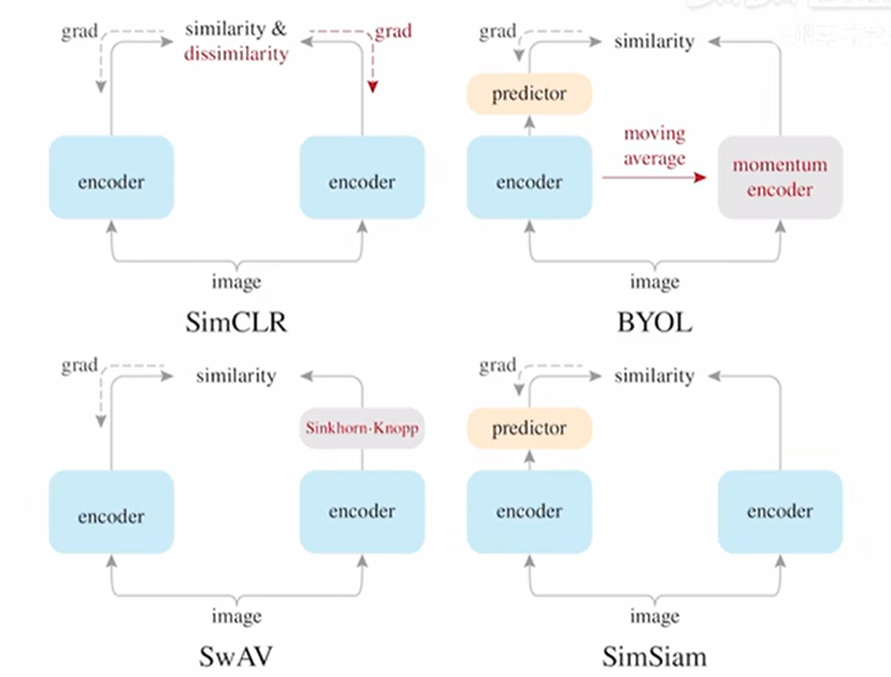
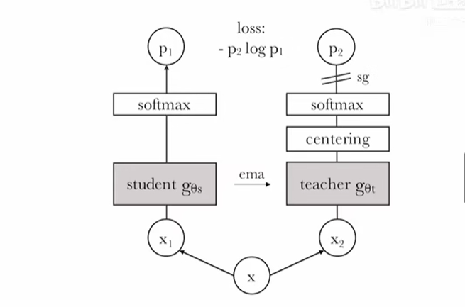
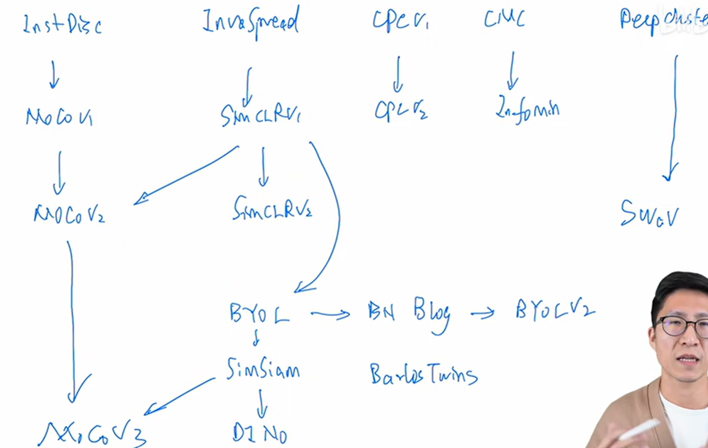