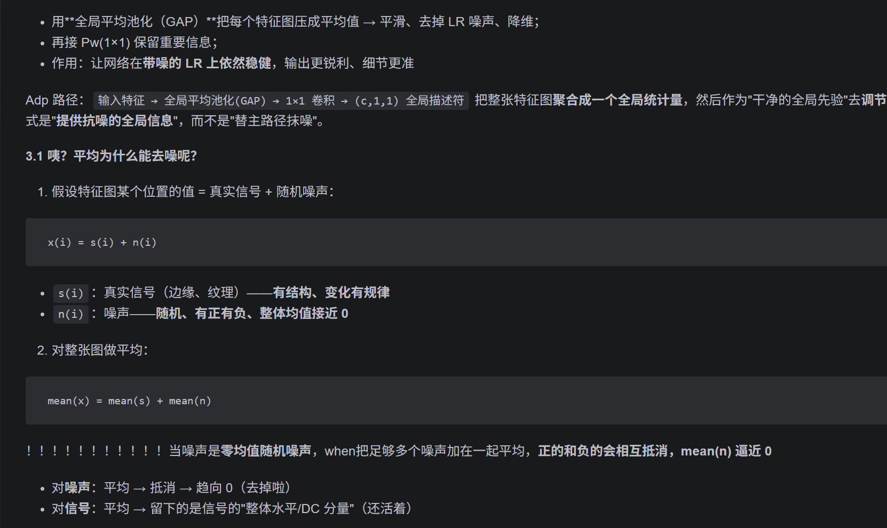
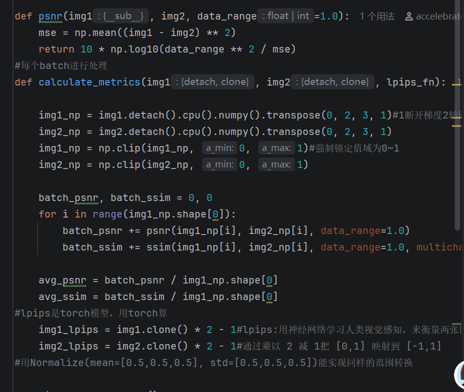
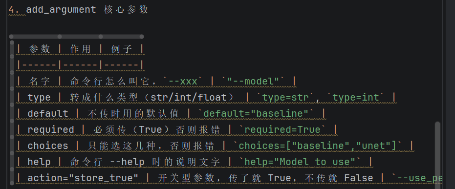

我确实使用了ai辅助，但是使用程度应该在合理范围内，出现的内容我都是理解并掌握了的
1. 对于笔记：
- 我的简单问题的回答都是我自己写的（不需要写太多字...）哈哈哈
- 附加题的笔记，我的习惯是让ai直接总结一份这样我就不用自己写框架（类似于目录），然后审核再把里面的内容自己重写，难绷，我看了一下我的笔记最后没删完的两部分，那个是ai写的，我觉得不太重要的板块打算把它那部分都删掉的，搞忘了

2. 对于代码：
- 我的derainnet这些简单的完全是自己写的，论文复现的代码我是每个模块分别尝试自己编写再和ai交流核对，我的笔记里面粘贴的都是最终版本（mpr也没有示例代码，我只能和ai对）
- mymodel在我分别复现完每个模块后只需要简单拼接，我最后让ai检查补充了细节问题，比如说预设为0，我在有一篇笔记中直接粘贴了ai的最终建议，我本来就是打算把它放那里的，因为不是我自己原本写的是ai给的修改地方我怕搞忘 
- 设计这个类的原因批注我不是很理解这个问题，我以为我都是复现了也没什么需要批注的，这些模块也不是我设计的呀...所以批注我都直接写的模块的内容核心，从笔记里面复制过来了
3. onnx b站上我找了一个教程可能要4小时左右讲的比较慢和冗余而且版本有点落后，我听了几节考虑之后决定跟着ai直接学，我认为这只是一个小部分，我只需要学会掌握最简单的导出就可以，以后还有其他用到的再补，所以笔记内容可能多数是对ai讲解的整理，确实很多
4. 这种批注是我理解文件夹里面其他文件时不懂的问的ai然后整上去的
反思了一下，招新所需的markdown是体现思路过程的，对于非简答问题的笔记我有强迫症又懒，希望尽可能的格式好看内容完善复习时方便看，但是最近期中临近，我有点着急，所以确实借助较多ai，大框架是ai写的， 抱歉wuwuwu
比如说这种
哎唉

扯皮这么多好像也没啥用...我可以保证我能解释90%的代码和笔记